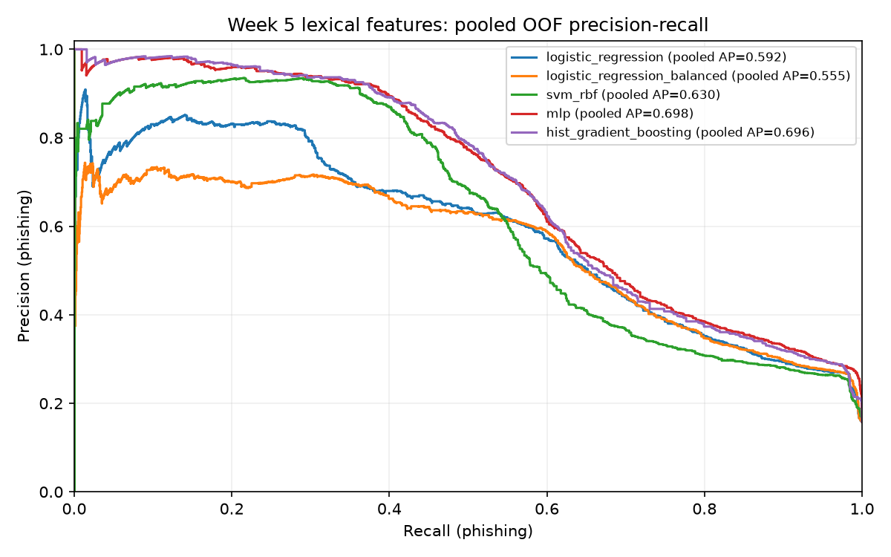
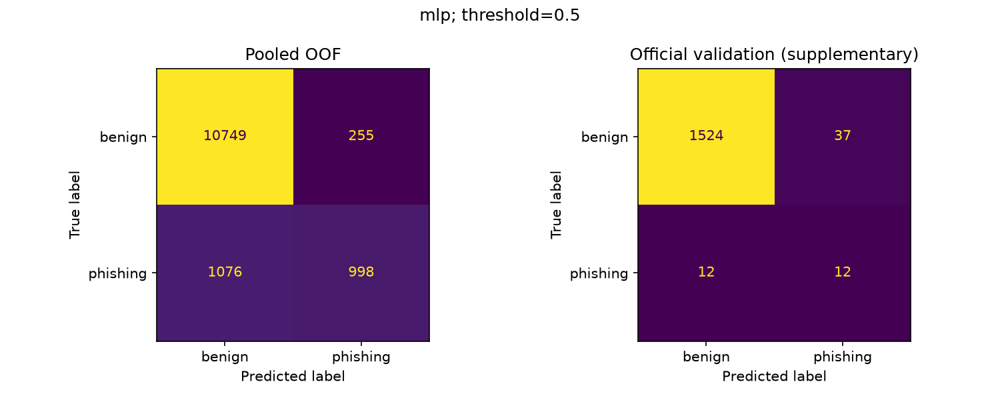

# Tuần 5 — so sánh mô hình trên 12 lexical features

Đây là phần có thể hoàn thành trước khi Hy bàn giao brand features. Chưa có ablation 12 vs 12+brand, chưa chốt Teacher cuối cùng, chưa huấn luyện KD hoặc triển khai mobile.

## Giao thức

- Train đủ điều kiện: 13078 URL; phishing: 2074.
- Official validation bổ sung: 1585 URL; phishing: 24.
- Dùng nguyên 3 outer domain folds của Hưng; chỉ train được dùng để fit/chọn cấu hình.
- Inner Group CV: 2 folds để chọn cấu hình theo AP trung bình. Những bước fit ở inner fold không nhìn outer held-out fold.
- SVM dùng sigmoid calibration với 2 group folds riêng bên trong mỗi tập đang fit, scaler nằm trong base pipeline.
- MLP và boosting tắt early stopping dùng holdout ngẫu nhiên; không dùng official validation để chọn cấu hình hoặc thời điểm dừng.
- Ngưỡng cố định: 0.5. AP là average precision; phishing = 1.
- Cùng ngưỡng 0,5 không bảo đảm cùng điểm vận hành giữa các thuật toán; đọc PR curve, Recall và FPR cùng nhau.
- Official test không được dự đoán/chấm. Feature set chỉ gồm 12 lexical features, không có source/tier/split/label trong X.
- Quyết định AP làm chính được Phúc xác nhận trước khi xem kết quả tuần 5; xem [giao thức](../../../docs/project/week5_protocol.md).

## Outer Group CV

Mỗi dòng dưới là trung bình ± độ lệch chuẩn mẫu qua các outer folds. AP/F1 từ OOF gộp có thể khác trung bình theo fold. So sánh này đánh giá cả quy trình chọn cấu hình trong train, không dùng cùng một cấu hình toàn train để nhìn trước các outer folds.

| Mô hình | AP | Precision | Recall | F1 | FPR |
|---|---:|---:|---:|---:|---:|
| logistic_regression | 0.5942 ± 0.0158 | 0.7300 ± 0.0294 | 0.3269 ± 0.0454 | 0.4500 ± 0.0431 | 0.0230 ± 0.0053 |
| logistic_regression_balanced | 0.5577 ± 0.0155 | 0.3449 ± 0.0125 | 0.8071 ± 0.0089 | 0.4831 ± 0.0107 | 0.2894 ± 0.0194 |
| svm_rbf | 0.6426 ± 0.0318 | 0.8396 ± 0.0379 | 0.4190 ± 0.0206 | 0.5585 ± 0.0172 | 0.0153 ± 0.0047 |
| mlp | 0.6992 ± 0.0140 | 0.7983 ± 0.0243 | 0.4812 ± 0.0482 | 0.5989 ± 0.0333 | 0.0232 ± 0.0053 |
| hist_gradient_boosting | 0.6979 ± 0.0226 | 0.8192 ± 0.0034 | 0.4822 ± 0.0322 | 0.6066 ± 0.0246 | 0.0201 ± 0.0018 |

Ứng viên dẫn đầu trên lexical-only theo quy tắc AP: **mlp**.
Đây là lựa chọn ứng viên để nghiên cứu tiếp, chưa phải phê duyệt Teacher hay lựa chọn triển khai. Điểm của family thắng đã tham gia quá trình chọn family, vì vậy không coi đó là ước lượng cuối cùng không thiên lệch cho model được chọn.

## AP từ OOF gộp

| Mô hình | Pooled OOF AP |
|---|---:|
| logistic_regression | 0.5923 |
| logistic_regression_balanced | 0.5553 |
| svm_rbf | 0.6297 |
| mlp | 0.6978 |
| hist_gradient_boosting | 0.6964 |

Các score OOF đến từ nhiều model fit theo các outer folds; pooled AP được báo cáo mô tả, không thay thế tiêu chí AP trung bình folds đã chốt.

## Official validation bổ sung

Mỗi family được chọn cấu hình lại chỉ bằng Group CV trên toàn train, rồi fit toàn train và chấm validation. Validation không quyết định cấu hình, family, feature hoặc threshold.

| Mô hình | AP | Precision | Recall | F1 | FPR | FP | FN |
|---|---:|---:|---:|---:|---:|---:|---:|
| logistic_regression | 0.2933 | 0.2553 | 0.5000 | 0.3380 | 0.0224 | 35 | 12 |
| logistic_regression_balanced | 0.2744 | 0.0344 | 0.9583 | 0.0664 | 0.4138 | 646 | 1 |
| svm_rbf | 0.2639 | 0.3462 | 0.3750 | 0.3600 | 0.0109 | 17 | 15 |
| mlp | 0.4314 | 0.2449 | 0.5000 | 0.3288 | 0.0237 | 37 | 12 |
| hist_gradient_boosting | 0.4338 | 0.3250 | 0.5417 | 0.4062 | 0.0173 | 27 | 11 |

Validation nhỏ ở lớp phishing và khác phân bố nguồn; đọc cùng support, FP/FN và FPR. Không xem một chênh lệch điểm đơn lẻ là bằng chứng đã xử lý source bias.

## Đối chiếu E1

LR thường và balanced vẫn là các đối chứng C=1 nếu chạy config mặc định. E1 chọn LR bằng F1; tuần 5 chọn cấu hình/family bằng AP theo quyết định mới. Vì vậy không thay tên hoặc ghi đè winner E1 bằng winner tuần 5.

| Đối chứng | Δ mean AP (tuần 5 − E1) | Δ mean F1 |
|---|---:|---:|
| logistic_regression | +0.00000000 | +0.00000000 |
| logistic_regression_balanced | +0.00000000 | +0.00000000 |

Các delta trên là đối chiếu output, không tự chứng minh hai lần chạy có cùng dữ liệu/thư viện; kiểm tra metadata khi có chênh lệch.

## Tái lập và trạng thái

- Có 48 dòng log inner search, 20 lựa chọn outer/full-train và 68 dòng fit log.
- Xem 05_fit_log.csv để biết convergence warning; không che cảnh báo bằng cách bỏ dòng log. Cấu hình có cảnh báo phải được diễn giải cùng chính sách hợp lệ trong giao thức.
- 05_split_audit.csv và 05_selections.csv cho phép kiểm tra cách chia/chọn; predictions giữ ID để Hưng phân tích source/fold errors.
- Runtime HEAD: `3e9001cac54f5027637e713c2d5f65d130bb17e3`; source state: `modified_from_head`.
- Metadata có hash source/config/handoff/model, phiên bản thư viện và runtime threads. HEAD là commit nền lúc chạy; hash xác định source thực tế nếu còn sửa.
- E1 code/config/output không được ghi đè bởi script tuần 5. Mỗi lần chạy tuần 5 sẽ thay các output 05 của lần trước.

```powershell
.\.venv\Scripts\python.exe scripts/train_week5.py
```

## Việc chờ Hy và cả nhóm

- Brand feature spec/dictionary/version và X E2 chưa được giả lập.
- Chờ Hy bàn giao để kiểm tra ID/schema và chạy 12 vs 12+brand trên cùng samples/folds.
- Cùng Hưng phân tích lỗi/robustness, cùng Khiêm đọc source bias/external evidence.
- Chỉ chốt Teacher sau khi đánh giá trade-off precision/recall/FPR, tài nguyên và đủ các thí nghiệm cần thiết.




