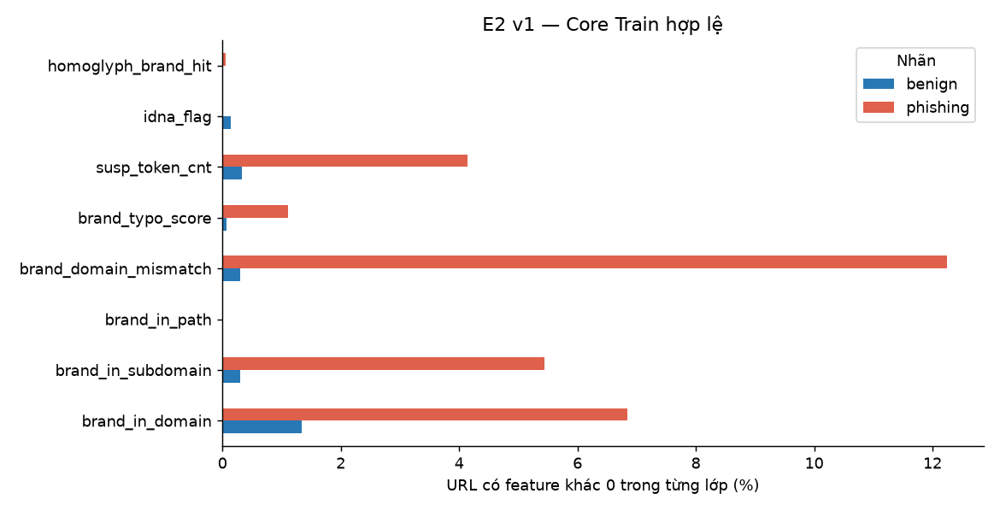
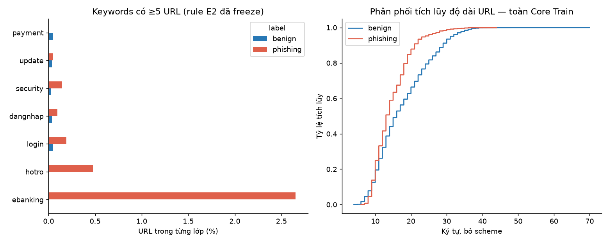
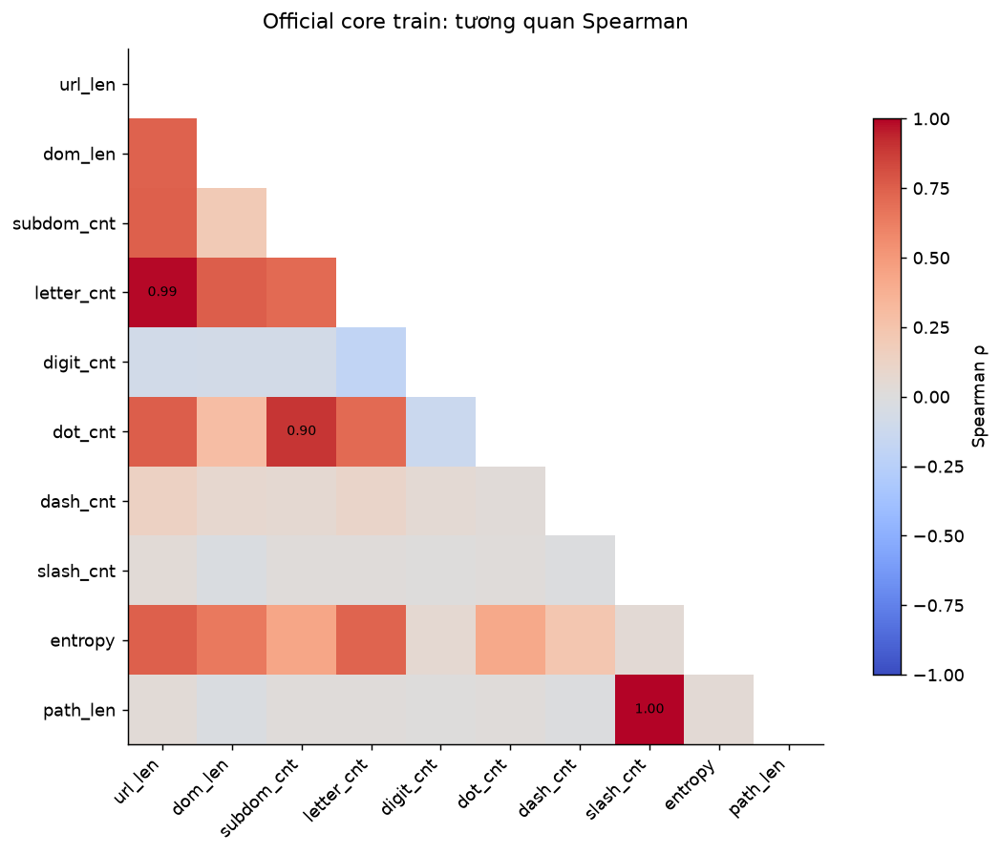

# Báo cáo dữ liệu PhishGuardVN — EDA và tiền xử lý

Phạm vi: bản sao PhishVN v3.1.0 trong repository; phân tích feature chỉ trên **Core Train hợp lệ**. Không huấn luyện/tune model, chọn feature, chỉnh nhãn/split, cap outlier hay truy cập URL đích. Các số liệu EDA được sinh từ notebook 02 và được giữ nguyên. Diễn giải trạng thái đã cập nhật sau merge PR #12/#13 trên main `d7a5a66`; xem [đối chiếu sau merge](post_merge_eda_review.md). Đây không phải cam kết điểm số.

## 1. Bài toán và đơn vị phân tích

PhishGuardVN nghiên cứu phân loại URL thành nhãn kế thừa `benign`/`phishing`, bằng thông tin có thể tính offline. Đơn vị là URL, không phải người dùng, email hay nội dung trang. Nhãn dương của nguồn là abuse/anti-fraud rộng hơn credential phishing; phát hiện chuỗi khả nghi không xác minh website đang độc hại.

## 2. Nguồn dữ liệu và trách nhiệm thu thập

PhishVN v3.1.0 do **Thai Nguyen Vu (UTC2)** công bố; xem [CITATION.cff](../CITATION.cff), DOI **10.17632/b97hxbxtpd.4**, [datasheet](../docs/datasheet.md) và [data sources](../docs/data_sources.md). Nhóm **không nhận công thu thập 53,116 URL gốc**.

Theo tài liệu tác giả: phishing đến từ NCSC/Tín Nhiệm Mạng (Gold/Silver), snapshot ChongLuaDao và OpenPhish (Bronze); benign từ registry/directory tín nhiệm, Tranco `.vn` và Tranco toàn cầu. Công cụ gốc gồm `scrape_vn_phishing.py`, `scrape_trusted_orgs.py`, `fetch_tranco.py`, `normalize_merge.py`; tên script này mô tả pipeline của tác giả, không khẳng định nhóm đã chạy lại các crawler. `dataset_url.csv` là bảng chính; `vn_compphish.csv` và các split là representation/subset của cùng URL, không nối dọc thành dữ liệu mới. `abuse_type.csv` chỉ để audit nhãn.

## 3. Phần nhóm thực hiện và định dạng lưu trữ

Nhóm kiểm định snapshot CSV UTF-8, giữ raw URL/ID/label/split, chọn Core theo tier đã quy định, chạy parser PSL offline, tạo E1/E2 và Group CV. 167 URL external do nhóm tổng hợp là **ứng viên**. Hai CSV nguồn giữ nguyên 167 `pending`; ledger sau PR #13 có 99 `verified` theo tài liệu ở scope hostname lịch sử (92 phishing/7 benign), 68 pending. Hưng đã xác nhận kiểm tra lại 99 trường hợp này: trạng thái trình bày hiện tại là **99 human-checked**, ghi riêng theo ID/signature tại [human check confirmation](annotations/k53_human_check_confirmation.csv). Đây là xác nhận do reviewer tự báo cáo, không phải một lần kiểm tra độc lập mới của công cụ; ngày kiểm tra thực tế chưa được cung cấp. 68 pending không được nâng trạng thái. External không đi vào Core, EDA feature, train/tuning hoặc metric. Provenance/evidence_ref nằm ở [external datasheet](../docs/external_datasheet.md) và [source audit](week5_data_reliability.md); có evidence_ref không đồng nghĩa nhãn đã accepted.

## 4. Quy trình trước/sau xử lý

| stage | input_rows | retained_rows | not_used_in_this_stage | affected_split | decision |
|---|---|---|---|---|---|
| Raw → Core Gold/Silver | 53116 | 18997 | 34119 | mọi split | Bronze giữ riêng; không xóa raw |
| Core → representation X hợp lệ | 18997 | 18995 | 2 | train | unresolved_domain ngoài X; vẫn còn trong Core |
| Core X → Train cho EDA/CV | 18995 | 13078 | 5917 | val + test | Holdouts giữ riêng, không phải dữ liệu lỗi |
| Riêng Core Train → Train hợp lệ | 13080 | 13078 | 2 | train | Cùng 2 unresolved_domain; không đếm loại thêm |

Core có 18,997 URL; X có 18,995; Core Train ban đầu 13,080, Train hợp lệ 13,078. Phần val/test giữ đúng vai trò holdout. Hai URL dưới đây có TLD không resolve được bằng snapshot PSL đang ghim; parser trả `unresolved_domain`, không phải bằng chứng nhãn sai hoặc URL độc hại. Không gom chúng thành một shared group, không tự gán vector 0 hay benign; raw/Core vẫn giữ nguyên.

| id | url | split | label | error_reason |
|---|---|---|---|---|
| 74648118-c397-5d04-ab64-9c2973953892 | vpbank[.]com[.]vn-uz[.]infor | train | phishing | unresolved_domain |
| 27984223-c2e3-5068-a777-02f4becd0d10 | techcombank[.]com-ut[.]xvz | train | phishing | unresolved_domain |

## 5. Làm sạch, missing, dtype và tiêu chí chất lượng

Kiểm tra tự động: ID duy nhất/không rỗng; nối `validate=one_to_one`; hợp nhất X và exclusions đúng bằng Core IDs, không giao nhau; schema E1 đúng 12 và E2 đúng 20 cột; dtype số, feature NaN/Inf bằng 0; split membership và URL/label/tier đối chiếu bản gốc; mỗi registrable domain thuộc đúng một CV fold. [Metadata inventory](tables/data_report/metadata_inventory.csv) ghi đủ 29 thuộc tính, dtype và missing. [Duplicate audit](tables/data_report/duplicates.csv) có 0 lần lặp sau bản đầu và 0 nhóm xung đột theo ID/raw URL/url_norm trong các phạm vi báo cáo; không chạy dedup/xóa thêm.

Các cột metadata hằng (kể cả hoàn toàn thiếu) trên snapshot: is_llm, has_ip, text, msg_len, gen_model, has_url; các trường text/message không tạo thêm modality văn bản ngoài URL. Chúng không nằm trong X URL đã freeze, không được diễn giải missing thành giá trị lành tính.

Missing metadata được giữ missing, không làm lý do loại URL. Không impute thời gian/nguồn; features không lấy các cột này. Parser lỗi không sinh feature; các feature hợp lệ là float64, cờ/đếm có ý nghĩa nguyên. Label chỉ map `benign=0`, `phishing=1` khi cần mô hình. Scaler/imputer/selector học từ dữ liệu phải fit trong fitting fold; EDA này không fit chúng.

Parser thêm scheme khi thiếu, chuẩn hóa **host** (lowercase, bỏ dấu chấm cuối, IDNA/UTS46, IP), giữ case path/query; feature độ dài/đếm dùng URL bỏ scheme, `dom_len` dùng registrable domain. Không dùng `url_norm` nguồn thay raw URL để trích features. Audit thực tế `url_norm` khớp strip + lowercase + thêm `http://` ở 53,116/53,116 dòng; mô tả nguồn nói “scheme stripped” không hoàn toàn khớp representation lưu. Đây là khác biệt tài liệu, không sửa CSV hoặc hạ chữ thường path để “làm sạch”.

Kiểm tra thủ công: datasheet nguồn mô tả một label audit của tác giả; báo cáo này không tái xác nhận audit đó và không tạo thêm human verification cho Core. Các case parser kỹ thuật được xem xét offline bằng fixtures và bảng exclusions. Phần human error review H5.2 của Hưng thuộc **PR #7 đã merge vào main tại `b7c5b16`**; không nhập hay ghi đè checklist đó và không đồng nhất với human check của external K5.3. Không dùng việc đọc chuỗi URL làm xác nhận nhãn/trang đích.

## 6. Quy mô, nhãn và mất cân bằng

| population | n | benign | phishing | phishing_pct |
|---|---|---|---|---|
| raw | 53116 | 16410 | 36706 | 69.105 |
| core | 18997 | 16410 | 2587 | 13.618 |
| bronze | 34119 | 0 | 34119 | 100.000 |
| core_train_before_parse | 13080 | 11004 | 2076 | 15.872 |
| core_train_eligible | 13078 | 11004 | 2074 | 15.859 |

Tỷ lệ phishing giảm 69.11% → 13.62% khi giữ riêng Bronze, vì Bronze chứa 34,119 phishing và 0 benign. Đây là **thay đổi thành phần theo tier**, không phải dữ liệu được “cân bằng thành công”. Core Train hợp lệ có 11,004 benign/2,074 phishing, tỷ lệ benign/phishing 5.31:1. Core Validation chỉ có 24 positive; không dùng nó để chọn preprocessing/feature. Official Test chỉ tham gia kiểm kê/integrity/domain overlap có sẵn, không vào thống kê feature hoặc lựa chọn.

Notebook 03 tái tạo representation deterministic của toàn Core (có Core Test) để giữ đúng artifact/coverage sẵn có. Việc đó không phải phân tích feature Test hoặc fit preprocessing/model trên Test; các bảng thống kê lexical/brand/keyword ở đây lọc Train trước khi tính.

## 7. EDA 12 lexical features — chỉ Train hợp lệ

Định nghĩa đầy đủ trong [feature dictionary](templates/feature_dictionary.csv); giữ nguyên thứ tự và công thức. [Bảng đầy đủ](tables/data_report/lexical_descriptive.csv) có 36 hàng (all/benign/phishing × 12), gồm count/missing/%, mean, median, std, variance, min, Q1, Q3, max, IQR, distinct và zero%. Std/variance mẫu dùng **ddof=1**, quantile nội suy tuyến tính; zero% có mẫu số là số giá trị không thiếu. Không tính correlation cho cột hằng; hằng và thưa vẫn ở X.

| feature | count | mean | median | variance | min | max | iqr | distinct_values | zero_pct_of_nonmissing |
|---|---|---|---|---|---|---|---|---|---|
| url_len | 13078 | 17.114 | 15.000 | 55.023 | 4.000 | 70.000 | 11.000 | 46 | 0.000 |
| dom_len | 13078 | 13.412 | 13.000 | 15.440 | 4.000 | 41.000 | 4.000 | 36 | 0.000 |
| is_ip | 13078 | 0.000 | 0.000 | 0.000 | 0.000 | 0.000 | 0.000 | 1 | 100.000 |
| subdom_cnt | 13078 | 0.436 | 0.000 | 0.414 | 0.000 | 6.000 | 1.000 | 6 | 64.643 |
| letter_cnt | 13078 | 14.942 | 14.000 | 44.294 | 2.000 | 62.000 | 9.000 | 43 | 0.000 |
| digit_cnt | 13078 | 0.204 | 0.000 | 0.608 | 0.000 | 22.000 | 0.000 | 12 | 90.771 |
| dot_cnt | 13078 | 1.854 | 1.000 | 1.049 | 1.000 | 8.000 | 2.000 | 6 | 0.000 |
| dash_cnt | 13078 | 0.110 | 0.000 | 0.117 | 0.000 | 6.000 | 0.000 | 7 | 89.647 |
| under_cnt | 13078 | 0.000 | 0.000 | 0.000 | 0.000 | 0.000 | 0.000 | 1 | 100.000 |
| slash_cnt | 13078 | 0.003 | 0.000 | 0.006 | 0.000 | 4.000 | 0.000 | 5 | 99.740 |
| entropy | 13078 | 3.279 | 3.323 | 0.116 | 1.459 | 4.172 | 0.437 | 1702 | 0.000 |
| path_len | 13078 | 0.018 | 0.000 | 0.377 | 0.000 | 45.000 | 0.000 | 12 | 99.740 |

Median theo lớp (count từng lớp ở §6):

| feature | benign | phishing |
|---|---|---|
| url_len | 16.000 | 13.000 |
| dom_len | 14.000 | 11.000 |
| is_ip | 0.000 | 0.000 |
| subdom_cnt | 0.000 | 0.000 |
| letter_cnt | 14.000 | 12.000 |
| digit_cnt | 0.000 | 0.000 |
| dot_cnt | 2.000 | 1.000 |
| dash_cnt | 0.000 | 0.000 |
| under_cnt | 0.000 | 0.000 |
| slash_cnt | 0.000 | 0.000 |
| entropy | 3.324 | 3.306 |
| path_len | 0.000 | 0.000 |

Các phân phối định lượng của **từng** feature nằm ở [lexical_distributions.csv](tables/data_report/lexical_distributions.csv), dùng các khoảng quantile chung từ Train và tỷ lệ riêng từng lớp; cột hằng ghi một mức duy nhất. Giữ nguyên quantile, boxplot và IQR của notebook 02, không vẽ 12 hình lặp nhau.

Nhận xét từ output:

1. Median độ dài URL benign/phishing = 16/13; domain length = 14/11. Độ dài phản ánh cấu trúc chuỗi, có thể gắn với nguồn thu thập; không có ngưỡng tự động chứng minh phishing.
2. Median entropy = 3.324/3.306 bit. Phân phối chồng lấn; entropy đo độ đa dạng ký tự, không đo ý định lừa đảo.
3. Cột hằng Train: is_ip, under_cnt. Việc giữ chúng là bảo toàn schema, không tuyên bố chúng đang cung cấp tín hiệu trong snapshot.
4. `path_len` bằng 0 ở 99.74% Train; URL chủ yếu ở mức hostname/domain. Vì vậy thiếu nhiều tín hiệu login/path không thể được diễn giải là website không có trang đăng nhập.
5. Cặp |Spearman| lớn nhất: slash_cnt/path_len (ρ=1.000). Xem sparsity và multicollinearity trước khi diễn giải nhiều cột như bằng chứng độc lập; không tự chọn/bỏ feature trong EDA.

## 8. EDA 8 brand features — E2 v1

Ma trận **Train+Validation đã tái tạo bằng script chính thức ở lần xuất báo cáo EDA**, chỉ lấy Train để phân tích; so manifest/schema/thứ tự, reference và hai dictionary với freeze đã commit. Schema `e2-brand-v1` có 12 lexical + 8 brand; reference có 45 brand với provenance verified. “Verified reference” không chứng minh nhãn URL hoặc bảo đảm độc lập với mọi nguồn/campaign. Không dùng v0; 12 lexical so theo ID khớp E1 (atol 1e-12, rtol 0).

| feature | benign_n | phishing_n | benign_pct | phishing_pct |
|---|---|---|---|---|
| brand_in_domain | 148 | 142 | 1.345 | 6.847 |
| brand_in_subdomain | 33 | 113 | 0.300 | 5.448 |
| brand_in_path | 0 | 0 | 0.000 | 0.000 |
| brand_domain_mismatch | 33 | 254 | 0.300 | 12.247 |
| brand_typo_score | 8 | 23 | 0.073 | 1.109 |
| susp_token_cnt | 36 | 86 | 0.327 | 4.147 |
| idna_flag | 15 | 0 | 0.136 | 0.000 |
| homoglyph_brand_hit | 0 | 1 | 0.000 | 0.048 |

Mẫu số: benign 11,004, phishing 2,074; tỷ lệ là URL có feature khác 0, không phải accuracy. `brand_domain_mismatch` có 287 Train URL; `brand_in_path` có 0; các feature ≥99% bằng 0: brand_in_path, brand_typo_score, susp_token_cnt, idna_flag, homoglyph_brand_hit. Hình thể hiện độ thưa và chênh lệch theo lớp, nhưng có thể phản ánh nguồn, whitelist và mức bao phủ reference.

[brand_descriptive.csv](tables/data_report/brand_descriptive.csv) có đủ moments/quantiles/zero%; [brand_value_counts.csv](tables/data_report/brand_value_counts.csv) cho phân phối mọi giá trị theo lớp, đặc biệt typo score và suspicious token count. Không thể kết luận brand features cải thiện dự đoán từ EDA; đánh giá đó thuộc thí nghiệm E1/E2 của Phúc, với đúng version và protocol.

## 9. EDA văn bản URL: cấu trúc và từ khóa

Cấu trúc dùng toàn bộ **13,080 Core Train**; domain/subdomain không resolve được giữ missing (2 dòng), không điền 0. URL length bỏ scheme; domain length là registrable domain; path length theo parser. Mean của `has_*` là tỷ lệ 0–1, nhân 100 để được %. “Special” là ký tự không thuộc Unicode letter/digit, gồm cả dấu chấm; thêm `has_special_beyond_dot` để tránh tỷ lệ luôn cao chỉ do hostname có dấu chấm. Kiểm tra percent escape, non-ASCII, query và whitespace là noise diagnostics, không phải quy tắc loại mẫu.

| feature | benign_mean | phishing_mean | benign_missing | phishing_missing |
|---|---|---|---|---|
| dash_cnt | 0.089 | 0.223 | 0 | 0 |
| digit_cnt | 0.127 | 0.609 | 0 | 0 |
| dom_len | 13.582 | 12.511 | 0 | 2 |
| dot_cnt | 1.950 | 1.346 | 0 | 0 |
| has_non_ascii | 0.000 | 0.000 | 0 | 0 |
| has_path | 0.002 | 0.005 | 0 | 0 |
| has_percent_escape | 0.000 | 0.000 | 0 | 0 |
| has_query | 0.000 | 0.000 | 0 | 0 |
| has_special | 1.000 | 1.000 | 0 | 0 |
| has_special_beyond_dot | 0.084 | 0.223 | 0 | 0 |
| outer_whitespace | 0.000 | 0.000 | 0 | 0 |
| path_len | 0.015 | 0.036 | 0 | 0 |
| special_cnt | 2.043 | 1.574 | 0 | 0 |
| subdom_cnt | 0.456 | 0.329 | 0 | 2 |
| url_len_no_scheme | 17.591 | 14.590 | 0 | 0 |

Keyword dùng 33 từ cố định trong `SUSPICIOUS_TOKENS`, có login/verify/secure/account/otp/update/support và các dạng tiếng Việt không dấu. Phương pháp chính gọi **API `explain_brand_matches`**: chỉ SLD, subdomain, path/query; percent-decode một lần ở path/query, casefold + NFKD bỏ dấu, token `[a-z0-9]+`; key ≥5 ký tự khớp substring trên các token nối trong từng vùng, key ngắn hơn khớp nguyên token. Không scan suffix TLD, scheme hoặc fragment. Dùng set event key nên một keyword xuất hiện nhiều lần vẫn chỉ đếm **một URL**. Tổng keyword hits từng ID được kiểm tra bằng chính `susp_token_cnt` của ma trận v1.

Rule nối token/substrings có thể gây false match qua dấu phân cách hoặc trong từ dài; nó là heuristic đã freeze, không tự sửa. Cột `strict_token_url_count` trong bảng là phân tích nhạy cảm với nguyên token trên hostname/path/query (percent-decode một lần, cùng case/accent folding), không gộp token và không sửa E2. Các rule có phạm vi khác nhau nên không trộn mẫu số hay xem chúng là tương đương.

| keyword | url_count_benign | url_count_phishing | url_pct_benign | url_pct_phishing | strict_token_url_count_benign | strict_token_url_count_phishing |
|---|---|---|---|---|---|---|
| ebanking | 0.000 | 55.000 | 0.000 | 2.652 | 0.000 | 52.000 |
| hotro | 1.000 | 10.000 | 0.009 | 0.482 | 0.000 | 1.000 |
| login | 5.000 | 4.000 | 0.045 | 0.193 | 3.000 | 0.000 |
| dangnhap | 4.000 | 2.000 | 0.036 | 0.096 | 2.000 | 1.000 |
| security | 3.000 | 3.000 | 0.027 | 0.145 | 1.000 | 2.000 |
| update | 4.000 | 1.000 | 0.036 | 0.048 | 0.000 | 1.000 |
| payment | 5.000 | 0.000 | 0.045 | 0.000 | 1.000 | 0.000 |
| nhanqua | 0.000 | 4.000 | 0.000 | 0.193 | 0.000 | 2.000 |
| account | 1.000 | 2.000 | 0.009 | 0.096 | 0.000 | 1.000 |
| secure | 3.000 | 0.000 | 0.027 | 0.000 | 0.000 | 0.000 |
| taikhoan | 0.000 | 3.000 | 0.000 | 0.145 | 0.000 | 1.000 |
| bonus | 2.000 | 0.000 | 0.018 | 0.000 | 0.000 | 0.000 |
| promo | 2.000 | 0.000 | 0.018 | 0.000 | 0.000 | 0.000 |
| support | 1.000 | 1.000 | 0.009 | 0.048 | 1.000 | 1.000 |
| wallet | 1.000 | 1.000 | 0.009 | 0.048 | 0.000 | 0.000 |

Vế trái chỉ hiển thị 7 keyword có ít nhất 5 URL trong Train; vế phải là ECDF độ dài trên toàn Core Train, không fit mật độ hay chọn ngưỡng. Top tối đa 15 keyword có quan sát được liệt kê ở bảng; toàn bộ 33 keyword, kể cả 0, nằm ở [keyword_frequencies.csv](tables/data_report/keyword_frequencies.csv). Nếu chưa đủ 10–15 từ đạt support ≥5, dữ liệu không cho phép diễn giải đáng tin tất cả chúng; không thêm mẫu/từ khóa để làm đẹp biểu đồ. Keyword `ebanking` xuất hiện trên 55 URL theo rule E2; sự xuất hiện ở URL benign cũng phù hợp dịch vụ ngân hàng hợp pháp. Một keyword/ký tự không tự chứng minh URL phishing; source-label confounding (§12) còn nguyên.

## 10. Tương quan và multicollinearity

Hình bỏ cột hằng khỏi phép tính vì correlation không xác định, không bỏ khỏi X. Nhiều count/length có thông tin trùng; tương quan thứ hạng không đồng nghĩa quan hệ tuyến tính chính xác hoặc nhân quả. [VIF](tables/data_report/lexical_vif.csv) bổ sung hồi quy tuyến tính từng cột thay đổi trên các cột còn lại, có intercept, chỉ Train. Rank = 10/10; condition number = 1.37e+03. VIF được ghi “infinite_or_numerically_singular” nếu residual fraction ≤1e-12, giá trị số để trống **có giải thích**, không gán NaN vào X. Không dùng pseudo-inverse của correlation để làm VIF giả hữu hạn và không áp dụng quy tắc loại cột. Diagnostic standardization chỉ tính trong bộ nhớ cho phép kiểm định số học, không là scaler của model.

| feature | vif | status |
|---|---|---|
| url_len | 240,324.514 | finite |
| dom_len | 4.262 | finite |
| subdom_cnt | 11.256 | finite |
| letter_cnt | 193,558.682 | finite |
| digit_cnt | 2,657.707 | finite |
| dot_cnt | 4,595.808 | finite |
| dash_cnt | 512.805 | finite |
| slash_cnt | 29.859 | finite |
| entropy | 2.245 | finite |
| path_len | 3.957 | finite |

## 11. Outliers và dữ liệu bất thường

| feature | lower_bound | upper_bound | outlier_n | outlier_pct |
|---|---|---|---|---|
| url_len | -5.500 | 38.500 | 39 | 0.298 |
| dom_len | 5.000 | 21.000 | 441 | 3.372 |
| is_ip | 0.000 | 0.000 | 0 | 0.000 |
| subdom_cnt | -1.500 | 2.500 | 6 | 0.046 |
| letter_cnt | -3.500 | 32.500 | 96 | 0.734 |
| digit_cnt | 0.000 | 0.000 | 1207 | 9.229 |
| dot_cnt | -2.000 | 6.000 | 1 | 0.008 |
| dash_cnt | 0.000 | 0.000 | 1354 | 10.353 |
| under_cnt | 0.000 | 0.000 | 0 | 0.000 |
| slash_cnt | 0.000 | 0.000 | 34 | 0.260 |
| entropy | 2.430 | 4.177 | 205 | 1.568 |
| path_len | 0.000 | 0.000 | 34 | 0.260 |

Ngưỡng Q1−1.5×IQR/Q3+1.5×IQR tính từ Train gộp; boxplot sẵn có dùng từng lớp nên số điểm có thể khác. Với count/cờ thưa, Q1=Q3=0 làm mọi giá trị khác 0 bị đánh dấu; đó không chứng minh dữ liệu sai. Giữ tất cả giá trị hợp lệ, không xóa/winsorize/cap; parser errors được tách riêng bằng lý do kỹ thuật, không bằng độ lớn feature.

## 12. Source bias, domain leakage, thời gian và giới hạn nhãn

| source | benign | phishing |
|---|---|---|
| tinnhiem_org | 1659 | 0 |
| tinnhiem_web | 3362 | 0 |
| tinnhiemmang | 0 | 2076 |
| tranco | 4170 | 0 |
| tranco_vn | 1813 | 0 |

5/5 nguồn Core Train chỉ có một nhãn. Metadata source không vào X vẫn không loại bỏ confounding: lexical/brand có thể là proxy của cách tuyển chọn nguồn. Không tuyên bố đã loại source bias. Đối chiếu source/source×split và external hiện có ở notebook 05 được giữ nguyên về tính toán; nhãn hiển thị được sửa từ “eligible” thành “trước lọc parser” vì bảng nguồn đó bao gồm cả hai dòng unresolved. Không đồng nhất 14,665 Core Train/Validation trước parser với 14,663 dòng trong X hợp lệ.

| pair | unique_a | unique_b | overlap_n | affected_a | affected_b | affected_total |
|---|---|---|---|---|---|---|
| train / val | 8835 | 1486 | 0 | 0 | 0 | 0 |
| train / test | 8835 | 1956 | 0 | 0 | 0 | 0 |
| val / test | 1486 | 1956 | 0 | 0 | 0 | 0 |

Group CV ba folds, seed 42, chỉ Train, mỗi registrable domain nằm một fold; split gốc không đổi. Không thấy overlap trên khóa resolve không chứng minh độc lập campaign, hạ tầng hoặc temporal generalization. PSL private suffix=False có thể gom các tenant chung hosting vào một registrable domain; không tự đổi chính sách.

| scope | column | n | missing | parsed | invalid_nonmissing |
|---|---|---|---|---|---|
| raw | collected_at | 53116 | 31455 | 21661 | 0 |
| raw | scraped_at | 53116 | 0 | 53116 | 0 |
| core_train | collected_at | 13080 | 9345 | 3735 | 0 |
| core_train | scraped_at | 13080 | 0 | 13080 | 0 |

Toàn snapshot thiếu 31,455 `collected_at`; có 21,661 parse được và 0 giá trị không rỗng lỗi parse. `collected_at` là ngày sự kiện theo nguồn, `scraped_at` là thời điểm snapshot; không thế lẫn, không điền ngày giả. Tài liệu nguồn mô tả split group-aware temporal; kiểm tra hiện tại xác minh membership/domain, **không xác nhận temporal holdout hoàn chỉnh** khi missing ngày và các lớp có cách thu thập khác nhau.

36,706/36,706 positive có chú giải abuse_type theo URL, nhưng nhóm `unknown` có 32,666 mẫu; bao phủ annotation không đồng nghĩa bao phủ loại tấn công hay nhãn gold do nhóm xác minh. Xem [abuse_types.csv](tables/data_report/abuse_types.csv). Không coi tất cả positive là đánh cắp thông tin xác thực. Không sử dụng abuse_type/scenario/impersonated_org như feature; nhãn và timestamp nguồn có giới hạn không thể khắc phục chỉ bằng EDA.

## 13. Tổ chức dữ liệu và tái lập

`data/*.csv`, `data/splits/`, `MANIFEST.txt`, `CITATION.cff` là input/version gốc; `data/interim/` là representation local bị gitignore, không phải raw đã thay. E1 = id + 12 feature; E2 = id + 20 feature, external tách tại `data/external/`. Bảng tổng hợp nhỏ ở `reports/tables/data_report/`; ba hình báo cáo ở `reports/figures/data_report/`. [eda_report_manifest.json](tables/data_report/eda_report_manifest.json) ghi hash input/code/reference/dictionary, phạm vi, schema, phiên bản và output. [data_report_verification.json](tables/data_report/data_report_verification.json) ghi lệnh, notebook cells, pytest, hash bất biến và giới hạn E2 verifier; chỉ ghi PASS sau chạy thật.

Thứ tự chạy: **01_data_quality → 03_url_features → build E2 trainval chính thức → 02_eda_and_splits → 05_source_bias → pytest**. Lệnh build: `python scripts/05_build_matrix_x_brand.py --partition trainval --freeze` trên checkout sạch. Nếu chỉ tái tạo từ checkout đang sửa báo cáo, bỏ `--freeze` sẽ tạo bản local unfrozen và cell guard từ chối; hãy dùng checkout sạch đúng source/reference, không tự đổi flag/falsify provenance. Báo cáo không đổi hay freeze lại dictionary/reference. Trên main sạch `d7a5a66`, verifier hiện có hai FAIL ở guard so toàn repository với commit freeze, dù bảy file producer/reference/dictionary vẫn byte-identical; exit 1 không được báo thành PASS. Xem nguyên nhân và đề xuất sửa riêng tại [đối chiếu sau merge](post_merge_eda_review.md#hai-fail-của-e2-freeze-verifier). Xem commands đầy đủ và notebook outputs đã chạy ở verification; các notebook không sửa chỉ giữ bản executed local để tránh commit outputs/hình trùng lớn.

## 14. Đối chiếu yêu cầu báo cáo môn học

Cột đầu là **đánh giá trước bổ sung** với ba trạng thái yêu cầu; cột cuối là kết quả và bằng chứng sau thực hiện. Chỉ những phần thiếu được bổ sung; các cell quantile/boxplot/Spearman/IQR/domain/CV và notebook nguồn vẫn được giữ.

| criterion | requirement | initial_status | final_status | evidence |
|---|---|---|---|---|
| 1 | Bài toán và nguồn gốc dữ liệu | Đã hoàn thành, có bằng chứng | Đạt | docs/datasheet.md; report §1–3 |
| 2 | Phương pháp thu thập, công cụ và attribution | Đã hoàn thành, có bằng chứng | Đạt (theo tài liệu nguồn) | docs/data_sources.md; report §2–3 |
| 3a | Nhiễu, ID/URL/url_norm trùng và xung đột nhãn | Đã hoàn thành, có bằng chứng | Đạt | 01-cell-06; 02-cell-06; duplicates.csv; report §5 |
| 3b | Missing, dtype, chuẩn hóa và chuyển đổi | Đã có nhưng cần bổ sung | Đạt | 01-cell-04/06; 03-cell-03; eda-report-quality; metadata_inventory.csv |
| 3c | Bảng trước/sau và 2 unresolved_domain | Đã có nhưng cần bổ sung | Đạt | eda-report-quality; preprocessing_flow.csv; excluded_rows.csv; report §4 |
| 4a | Tiêu chí chất lượng và kiểm tra tự động | Đã hoàn thành, có bằng chứng | Đạt | 03 handoff check; tests/test_splits.py; report §5 |
| 4b | Kiểm tra thủ công và giới hạn nhãn | Đã có nhưng cần bổ sung | Đạt về mô tả; không có xác minh mới | docs/datasheet.md; report §5, §12; PR #7 riêng |
| 5 | Lưu trữ, version, provenance và khả năng tái lập | Đã có nhưng cần bổ sung | Đạt | data/README.md; eda_report_manifest.json; data_report_verification.json; report §13 |
| 6a | Số mẫu/thuộc tính/tỷ lệ thiếu, imbalance | Đã hoàn thành, có bằng chứng | Đạt | 02-cell-04; class_populations.csv; metadata_inventory.csv; report §6 |
| 6b | Count, mean, median, std, variance, min/max, Q1/Q3/IQR | Đã có nhưng cần bổ sung | Đạt | eda-report-statistics; lexical_descriptive.csv (36 hàng); report §7 |
| 6c | Phân bố từng thuộc tính và theo nhãn | Đã có nhưng cần bổ sung | Đạt | 02-cell-10 (giữ quantile/boxplot); lexical_distributions.csv; report §7 |
| 6d | Tương quan giữa thuộc tính | Đã hoàn thành, có bằng chứng | Đạt | 02-cell-10; lexical_spearman.csv; lexical_correlated_pairs.csv; report §10 |
| 6e | Multicollinearity và hằng/thưa | Đã có nhưng cần bổ sung | Đạt | eda-report-statistics; lexical_vif.csv; report §10 |
| 6f | Outliers và giá trị bất thường | Đã hoàn thành, có bằng chứng | Đạt | 02-cell-10; lexical_iqr_outliers.csv; report §11 |
| 6g | EDA 8 brand features đúng v1 | Chưa có | Đạt | eda-report-brand; brand_descriptive.csv; brand_value_counts.csv; report §8 |
| 7a | Độ dài, path, chữ số, ký tự đặc biệt | Đã có nhưng cần bổ sung | Đạt | eda-report-text; url_structure.csv; report §9 |
| 7b | Tần suất keyword, mẫu số và quy tắc matching | Chưa có | Đạt; diễn giải bị giới hạn bởi sparsity | eda-report-text; keyword_frequencies.csv; report §9 |
| 7c | Nhiễu văn bản và giới hạn ý nghĩa keyword | Đã có nhưng cần bổ sung | Đạt | url_structure.csv; report §9, §12 |
| 8 | Domain leakage, Train-only và không đổi folds | Đã hoàn thành, có bằng chứng | Đạt trong phạm vi khóa đã resolve | 02-cell-06/08; domain_overlap.csv; fold_summary.csv; verification |
| 9 | Source-label bias và missing timestamps | Đã có nhưng cần bổ sung | Đạt (phát hiện, chưa loại bỏ) | 05_source_bias.ipynb (scope trước lọc parser); source_labels_train.csv; timestamps.csv; report §12 |
| 10 | Báo cáo dữ liệu tiếng Việt thống nhất | Chưa có | Đạt | reports/data_report_final.md; cell eda-report-final |

## 15. Kết luận và hướng sử dụng cho ML

Báo cáo bao phủ EDA/preprocessing theo checklist được cung cấp bằng số liệu chạy thật; không cam kết 10/10. Core/representation/folds giữ nguyên; 12 lexical và 8 brand được mô tả đủ với Train-only scope. Sử dụng kết quả để hiểu dữ liệu và nêu giới hạn; nếu học imputer/scaler/selector phải fit trong từng fitting fold, nếu đánh giá cải thiện cần thí nghiệm E1/E2 đúng version, không suy từ EDA. Các giới hạn còn lại gồm nhãn kế thừa/abuse rộng, source bias, thiếu thời gian, feature/keyword thưa, label/reference independence cần đánh giá; external có 99 human-checked theo tài liệu lịch sử nhưng 68 pending, source–label confounding còn và chưa có Teacher finalized để chạy recall pilot. Không có external benchmark hay metric chính thức. Các điểm này phải được nêu khi bảo vệ báo cáo; không bị che bằng thêm kỹ thuật hoặc thay split.

Đối chiếu bổ sung với `ml-data.pdf` của thầy (3 trang, bản local đã đọc) xác nhận đủ bằng chứng cho 21 mục trong §14; xem mapping theo trang, hash PDF và giới hạn ở [đối chiếu sau merge](post_merge_eda_review.md). External benchmark và sửa guard verifier không được nhận là kết quả EDA mới.

## 16. Tài liệu tham khảo và bằng chứng

- PhishVN v3.1.0: [CITATION](../CITATION.cff), DOI 10.17632/b97hxbxtpd.4; [datasheet](../docs/datasheet.md), [nguồn](../docs/data_sources.md), [schema](../docs/schema.md). Các mô tả thu thập/audit gốc được quy cho tác giả, không xác nhận lại bằng crawl.
- [01 — quality](../notebooks/01_data_quality.ipynb), [03 — parser/E1](../notebooks/03_url_features.ipynb), [02 — EDA/CV/bổ sung](../notebooks/02_eda_and_splits.ipynb), [05 — source/external](../notebooks/05_source_bias.ipynb).
- [E2 contract](../docs/mobile_feature_contract.md), [brand dictionary](templates/brand_feature_dictionary.csv), [freeze trainval](tables/05_matrix_X_brand_trainval_v1.manifest.json); [data reliability](week5_data_reliability.md).
