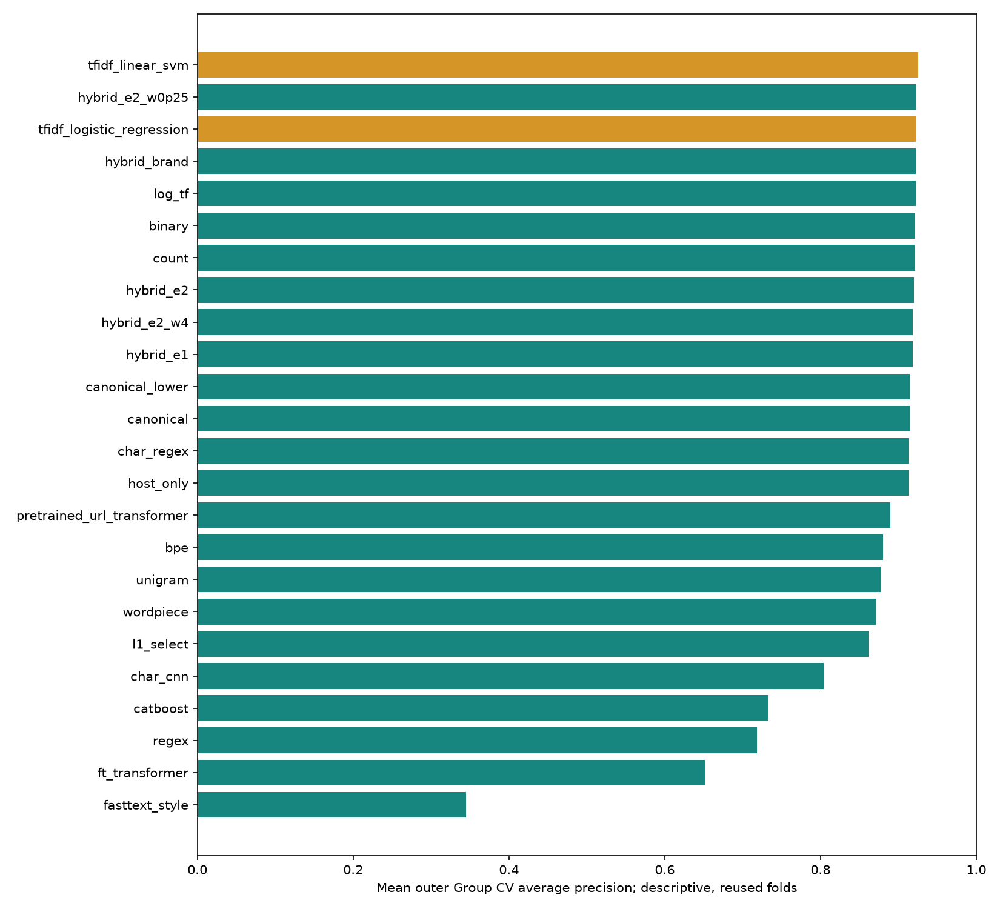

# Nghiên cứu URL preprocessing để đề xuất candidate

Trạng thái: **candidate_proposed, teacher_finalized=false**. Làm tiếp trên phuc-week6-teacher-v1 theo yêu cầu mới. Benchmark 13 model tại PR #24 được giữ nguyên; số liệu mới nằm riêng trong reports/tables/url_research.

## Kế hoạch và protocol

Không tìm thấy grid 496/224 đủ chi tiết trong workspace/repo/issue đã đọc. Đây là kế hoạch mới đăng ký trước kết quả trong configs/url_research_plan.json (commit 1d10cdc), không nhận là tái lập 496. Có 21 nhóm, 42 cấu hình: 252 inner fits + 63 outer refits, cộng tối đa 10 full-Train fits. Kế hoạch không nhân mọi preprocessing với mọi classifier.

Cùng 13.078 Train IDs, 3 domain outer folds; 2 inner StratifiedGroupKFold trong fitting. Vocabulary, DF/IDF, scaler, selector và tokenizer học trong từng fit. Không dùng Validation/Official Test/external, ID/nhãn/source làm đầu vào. Neural dùng fixed epoch budget, không early-stop bằng holdout và không nhận đã hội tụ chỉ vì hoàn tất epochs. Seed 42, CPU 2 threads. Mean/SD ba folds không phải CI; các folds đã được quan sát nhiều lần, so sánh không là kiểm chứng độc lập sau lựa chọn.

| Experiment | Group | Status | Baseline | Grid | Inner fits | Outer refits |
| --- | --- | --- | --- | --- | --- | --- |
| hybrid_e1 | A | completed | tfidf_logistic_regression | {"C": [0.5, 2]} | 12 | 3 |
| hybrid_brand | A | completed | tfidf_logistic_regression | {"C": [0.5, 2]} | 12 | 3 |
| hybrid_e2 | A | completed | tfidf_logistic_regression | {"C": [0.5, 2]} | 12 | 3 |
| hybrid_e2_w0p25 | A | completed | hybrid_e2 | {"C": [0.5, 2]} | 12 | 3 |
| hybrid_e2_w4 | A | completed | hybrid_e2 | {"C": [0.5, 2]} | 12 | 3 |
| regex | B | completed | tfidf_logistic_regression | {"C": [0.5, 2]} | 12 | 3 |
| char_regex | B | completed | tfidf_logistic_regression | {"C": [0.5, 2]} | 12 | 3 |
| l1_select | C | completed | tfidf_logistic_regression | {"C": [0.5, 2]} | 12 | 3 |
| bpe | D | completed | tfidf_logistic_regression | {"C": [0.5, 2]} | 12 | 3 |
| wordpiece | D | completed | tfidf_logistic_regression | {"C": [0.5, 2]} | 12 | 3 |
| unigram | D | completed | tfidf_logistic_regression | {"C": [0.5, 2]} | 12 | 3 |
| canonical | E | completed | tfidf_logistic_regression | {"C": [0.5, 2]} | 12 | 3 |
| canonical_lower | E | completed | tfidf_logistic_regression | {"C": [0.5, 2]} | 12 | 3 |
| host_only | E | completed | tfidf_logistic_regression | {"C": [0.5, 2]} | 12 | 3 |
| count | F | completed | tfidf_logistic_regression | {"C": [0.5, 2]} | 12 | 3 |
| binary | F | completed | tfidf_logistic_regression | {"C": [0.5, 2]} | 12 | 3 |
| log_tf | F | completed | tfidf_logistic_regression | {"C": [0.5, 2]} | 12 | 3 |
| char_cnn | neural | completed | tfidf_linear_svm | {"epochs": [2, 4]} | 12 | 3 |
| fasttext_style | neural | completed | tfidf_linear_svm | {"epochs": [2, 4]} | 12 | 3 |
| ft_transformer | neural | completed | catboost | {"epochs": [2, 4]} | 12 | 3 |
| pretrained_url_transformer | neural | completed | tfidf_linear_svm | {"learning_rate": [0.0002, 0.0005]} | 12 | 3 |

Thực tế: 325 fit thành công, 0 fit thất bại, tổng 325. Config status: {'success': 42}. Baseline CatBoost/E2, TF-IDF LR và TF-IDF SVM tái sử dụng OOF đã xác nhận, không fit lại để đổi baseline char 3–5.

## Triển khai và biểu diễn

A: char TF-IDF LR ghép E1, brand, E2; đối chứng trọng số numeric 0,25/1/4. Numeric vẫn trích từ URL gốc, giữ công thức và thứ tự freeze; StandardScaler học trong fitting, không chuẩn hóa lại feature definitions.
B: regex giữ tiền tố component scheme/host/path/query/fragment và delimiter tokens. Char+regex là hai nhánh độc lập. Scheme absent là tín hiệu định dạng có thể liên quan nguồn, không phải chứng cứ phishing.
C: L1 LogisticRegression selector C=1 trong pipeline, classifier LR chọn C 0,5/2; số cột trước/sau trong fold_metrics.csv. Selector không tự rút gọn vocabulary gốc khi serialize nên ít cột không bảo đảm file nhỏ hơn.
D: BPE/WordPiece/Unigram vocab tối đa 2.048, pretokenize delimiter rồi ByteLevel. Tokenizer vocabulary tạo token IDs/tokens, vectorizer vocabulary tạo cột sparse và IDF: hai mapping khác nhau, đều fit riêng trong fitting. [UNK] rõ ràng; tokenizer nghiên cứu không thay vào pretrained embeddings.
E: raw; canonical bỏ scheme/userinfo/fragment, lower+IDNA host, bỏ port mặc định, giữ path/query case và percent escapes; canonical_lower còn lower path/query (mất thông tin); host_only bỏ cả port/path/query. URL parser lỗi giữ raw để không loại ID. Không sửa raw CSV.
F: Count/Binary/Log-TF so với TF-IDF trên cùng char 3–5, min_df=2, max_features=50.000, L2 norm; chỉ thay weighting/IDF tương ứng.
Char-CNN: vocab ký tự fitting-only, PAD=0/UNK=1, dài 256, embed32, Conv kernels3/5/7×32, global max pooling.
FastText-style: vocab từ fitting-only + hashed char subwords 3–5 trong từng token, word/subword embeddings học supervised rồi mean pooling. Không phải TF-IDF và không tuyên bố là package FastText chính thức.
FT-Transformer: 20 số E2, scaler fitting-only, feature-specific affine tokens 32 chiều, CLS, 1 attention block/2 heads. Không dùng BPE cho cột số.
URL Transformer: google/bert_uncased_L-2_H-128_A-2, revision 30b0a37ccaaa32f332884b96992754e246e48c5f, Apache 2.0; đúng WordPiece vocab của encoder, uncased, max64 tokens, end-to-end fine-tune 2 epochs, LR2e-4/5e-4. Truncation/case có thể mất thông tin. Nguồn [model card](https://huggingface.co/google/bert_uncased_L-2_H-128_A-2); hashes checkpoint trong verification.json.

## Kết quả từ OOF đã lưu

| Pipeline | AP mean | SD | Recall | FPR | F1 | Model KiB (outer / cached full) |
| --- | --- | --- | --- | --- | --- | --- |
| tfidf_linear_svm | 0.9256 | 0.0137 | 77.77% | 1.14% | 0.8463 | 1523.6 |
| hybrid_e2_w0p25 | 0.9232 | 0.0022 | 72.13% | 1.03% | 0.8123 | 1109.8 |
| tfidf_logistic_regression | 0.9222 | 0.0109 | 70.83% | 0.77% | 0.8098 | 1523.7 |
| hybrid_brand | 0.9220 | 0.0096 | 70.73% | 0.80% | 0.8085 | 1109.3 |
| log_tf | 0.9218 | 0.0088 | 71.46% | 0.97% | 0.8091 | 898.5 |
| binary | 0.9218 | 0.0089 | 71.50% | 0.96% | 0.8097 | 898.5 |
| count | 0.9218 | 0.0087 | 71.41% | 0.98% | 0.8086 | 898.5 |
| hybrid_e2 | 0.9200 | 0.0051 | 73.14% | 1.09% | 0.8175 | 1109.8 |
| hybrid_e2_w4 | 0.9184 | 0.0059 | 73.00% | 1.14% | 0.8155 | 1109.8 |
| hybrid_e1 | 0.9183 | 0.0058 | 72.71% | 1.02% | 0.8163 | 1109.4 |
| canonical_lower | 0.9145 | 0.0123 | 69.72% | 0.92% | 0.7987 | 1074.0 |
| canonical | 0.9145 | 0.0123 | 69.72% | 0.92% | 0.7987 | 1073.9 |
| char_regex | 0.9137 | 0.0114 | 71.70% | 1.16% | 0.8061 | 1148.9 |
| host_only | 0.9136 | 0.0126 | 69.72% | 0.92% | 0.7987 | 1071.8 |
| pretrained_url_transformer | 0.8891 | 0.0091 | 76.28% | 3.20% | 0.7888 | 17555.2 |
| bpe | 0.8798 | 0.0171 | 65.09% | 1.28% | 0.7571 | 118.5 |
| unigram | 0.8767 | 0.0090 | 65.62% | 1.39% | 0.7584 | 136.0 |
| wordpiece | 0.8706 | 0.0166 | 63.89% | 1.31% | 0.7479 | 99.2 |
| l1_select | 0.8621 | 0.0100 | 52.02% | 0.88% | 0.6636 | 1110.3 |
| char_cnn | 0.8036 | 0.0452 | 51.89% | 1.67% | 0.6419 | 72.3 |
| catboost | 0.7332 | 0.0037 | 49.81% | 1.57% | 0.6292 | 225.1 |
| regex | 0.7186 | 0.0084 | 51.06% | 1.57% | 0.6405 | 43.2 |
| ft_transformer | 0.6512 | 0.0176 | 39.83% | 1.94% | 0.5258 | 49.7 |
| fasttext_style | 0.3450 | 0.0154 | 0.00% | 0.00% | 0.0000 | 1087.4 |

AP là average_precision_score. Dự đoán dùng 0,5 probability; baseline SVM dùng margin 0. Tính lại từ CSV float_precision=round_trip, max error 0.0. Mỗi pipeline đủ đúng IDs/folds, không trùng ID. Hướng chưa hoàn thành phải đọc experiment_status.csv/config_status.csv, không xem là đã chạy.

## Delta theo baseline của từng giả thuyết

| Experiment | Baseline | Mean delta AP | Mean delta FP | Mean delta FN |
| --- | --- | --- | --- | --- |
| binary | tfidf_logistic_regression | -0.0004 | +7.00 | -4.67 |
| bpe | tfidf_logistic_regression | -0.0423 | +18.67 | +39.67 |
| canonical | tfidf_logistic_regression | -0.0077 | +5.33 | +7.67 |
| canonical_lower | tfidf_logistic_regression | -0.0077 | +5.33 | +7.67 |
| char_cnn | tfidf_linear_svm | -0.1220 | +19.67 | +179.00 |
| char_regex | tfidf_logistic_regression | -0.0085 | +14.33 | -6.00 |
| count | tfidf_logistic_regression | -0.0004 | +7.67 | -4.00 |
| fasttext_style | tfidf_linear_svm | -0.5807 | -41.67 | +537.67 |
| ft_transformer | catboost | -0.0820 | +13.67 | +69.00 |
| host_only | tfidf_logistic_regression | -0.0086 | +5.33 | +7.67 |
| hybrid_brand | tfidf_logistic_regression | -0.0002 | +1.00 | +0.67 |
| hybrid_e1 | tfidf_logistic_regression | -0.0038 | +9.00 | -13.00 |
| hybrid_e2 | tfidf_logistic_regression | -0.0022 | +11.67 | -16.00 |
| hybrid_e2_w0p25 | hybrid_e2 | +0.0032 | -2.33 | +7.00 |
| hybrid_e2_w4 | hybrid_e2 | -0.0016 | +1.67 | +1.00 |
| l1_select | tfidf_logistic_regression | -0.0601 | +4.00 | +130.00 |
| log_tf | tfidf_logistic_regression | -0.0003 | +7.33 | -4.33 |
| pretrained_url_transformer | tfidf_linear_svm | -0.0365 | +75.67 | +10.33 |
| regex | tfidf_logistic_regression | -0.2035 | +29.33 | +136.67 |
| unigram | tfidf_logistic_regression | -0.0454 | +22.67 | +36.00 |
| wordpiece | tfidf_logistic_regression | -0.0516 | +19.67 | +48.00 |

paired_deltas.csv có từng fold cho AP/Precision/Recall/F1/FPR. error_changes.csv và slices.csv tách corrected/new FP/FN, có sample/class counts cho scheme, query, IDN/Unicode, brand, URL ngắn. Nhóm nhỏ chỉ mô tả. So sánh các nhóm A–F giữ classifier family LR nhưng C được chọn riêng; neural khác cả biểu diễn và classifier, không quy hết delta cho preprocessing. Char TF-IDF LR/SVM cached là đối chứng classifier giữ biểu diễn.

cases.csv chọn tối đa hai ID theo thứ tự cố định mỗi fold×corrected/new_error, chứa score/config/nhãn và URL defang, observation/hypothesis/next_check. Không truy cập URL, tự sửa nhãn hoặc tune rule theo case. Feature-based error notes không dùng để giải thích nhân quả một model text.

## Candidate và tài nguyên

Đề xuất chính: **tfidf_linear_svm**. Phương án gọn trong khoảng 0,01 AP và file nhỏ hơn: **binary**.
Cấu hình full Train được chọn bằng inner Group CV trong grid đăng ký; mean outer AP là điểm mô tả family procedure, không phải đánh giá độc lập của riêng cấu hình full-Train. Candidate artifacts local dưới data/interim/url_research, metadata/hash ở candidate_proposal.json. Không sửa Teacher lock, artifact MLP cũ hoặc API/Web/Android/KD.

Tất cả latency mới đo CPU offline URL→score, có extraction numeric khi nhánh cần; batch16, warmup2, repeat5. Baseline lịch sử đo scope khác nên không ghép vào cùng bảng latency. Kích thước, số cột và thời gian từng fold ở fold_metrics.csv; số full Train ở candidate_proposal.json. Chưa benchmark điện thoại.

## Tái lập và kiểm chứng

Cài CPU PyTorch theo pyproject và pip install -e ".[teacher,test,research]". Chạy scripts/prepare_url_research.py tải checkpoint pinned, scripts/run_url_research.py (hoặc --classical-only rồi --resume), sau đó scripts/summarize_url_research.py. Cần handoff core/E2/domains/folds như benchmark. Không chạy notebook 06 để tái lập nghiên cứu này.

Code: src/phishguard_vn/research_preprocessing.py; research_neural.py; scripts/run_url_research.py. Fit ledger ghi config/partition IDs hash, time, lỗi, warnings và loss lịch sử neural. partitions.csv.gz cho phép audit group leakage. Không suy ra OOF tự chứng minh lịch sử fit; cần đối chiếu ledger và code.

Candidate reload được đối chiếu với model gốc. Kiểm thử fixture mới ở tests/test_url_research.py, kết quả test thực tế được bổ sung vào verification.json. Không gọi hoàn thành nghiên cứu nếu status còn nhóm chưa chạy/blocker. Teacher chỉ được đóng gói sau khi nhóm chốt candidate và contract.

## Diễn giải đối chứng và FP/FN

Giữ cùng LR family: hybrid E2 weight0,25 đổi AP so với raw TF-IDF LR khoảng +0.0010; hybrid weight1/4 không mang lại cùng kết quả. Vì mỗi pipeline chọn C trong inner CV, đây là đóng góp nhánh/trọng số của quy trình, không là hiệu ứng nhân quả của một feature.

Regex-only đổi AP -0.2035; char+regex cũng không thắng raw char LR trong lượt này. Token nguyên đoạn mất những tương đồng nhỏ bên trong domain mà char n-gram giữ; đó là giả thuyết phù hợp kết quả, cần kiểm tra vocabulary/case chứ không coi là chứng minh.

BPE/WordPiece/Unigram có vocab khoảng 2K và file outer nhỏ hơn nhiều nhưng AP thấp hơn raw char LR. Đây là trade-off nén/biểu diễn ở cấu hình đã thử, không chứng minh mọi subword đều kém. So min_df, unknowns và domain segment trong fitting trước khi mở rộng grid.

Canonical/host-only làm giảm AP. Bỏ scheme/path/query có thể giảm format/source cues nhưng cũng bỏ thông tin thật. Canonical_lower so với canonical gần như không đổi trong dữ liệu này; không suy ra path/query case luôn vô ích. Đọc slices.csv cùng class counts, nhất là has_scheme chỉ có benign trong Train; đó là audit phân bố, không dùng format làm nhãn.

L1 giảm mạnh số feature nhưng AP giảm; artifact vẫn chứa vocabulary và selector nên ít cột không bảo đảm giảm bytes. Count/Binary/Log-TF khá gần TF-IDF về AP nhưng điểm Recall/FPR ở ranh giới mặc định khác nhau; không gọi các operating points là cùng FPR.

Neural dùng ngân sách epochs/LR nhỏ khác với LR tối ưu tới điều kiện solver. Kết quả thấp chỉ cho thấy các kiến trúc/cấu hình/ngân sách đã chạy chưa thay được baseline; không kết luận đã tối ưu hết họ mô hình. FastText-style có Recall 0 ở ngưỡng 0,5 trong đợt này, vì vậy không dùng nó làm candidate dù file có thể nhỏ.

| Pipeline | Baseline | FP sửa được | FP mới | FN sửa được | FN mới |
| --- | --- | --- | --- | --- | --- |
| hybrid_e1 | tfidf_logistic_regression | 17 | 44 | 102 | 63 |
| hybrid_brand | tfidf_logistic_regression | 7 | 10 | 25 | 27 |
| hybrid_e2 | tfidf_logistic_regression | 18 | 53 | 105 | 57 |
| hybrid_e2_w0p25 | hybrid_e2 | 15 | 8 | 18 | 39 |
| hybrid_e2_w4 | hybrid_e2 | 1 | 6 | 4 | 7 |
| regex | tfidf_logistic_regression | 38 | 126 | 87 | 497 |
| char_regex | tfidf_logistic_regression | 17 | 60 | 91 | 73 |
| l1_select | tfidf_logistic_regression | 27 | 39 | 35 | 425 |
| bpe | tfidf_logistic_regression | 40 | 96 | 107 | 226 |
| wordpiece | tfidf_logistic_regression | 37 | 96 | 96 | 240 |
| unigram | tfidf_logistic_regression | 34 | 102 | 115 | 223 |
| canonical | tfidf_logistic_regression | 5 | 21 | 2 | 25 |
| canonical_lower | tfidf_logistic_regression | 5 | 21 | 2 | 25 |
| host_only | tfidf_logistic_regression | 5 | 21 | 3 | 26 |
| count | tfidf_logistic_regression | 8 | 31 | 49 | 37 |
| binary | tfidf_logistic_regression | 9 | 30 | 51 | 37 |
| log_tf | tfidf_logistic_regression | 8 | 30 | 49 | 36 |
| char_cnn | tfidf_linear_svm | 78 | 137 | 49 | 586 |
| fasttext_style | tfidf_linear_svm | 125 | 0 | 0 | 1613 |
| ft_transformer | catboost | 68 | 109 | 34 | 241 |
| pretrained_url_transformer | tfidf_linear_svm | 57 | 284 | 147 | 178 |

Các số ở bảng là tổng OOF paired trên cùng IDs; corrected/new FP/FN phải xem cùng AP và operating point, không đếm riêng số lỗi sửa rồi bỏ qua lỗi mới.

## Case minh họa chọn cố định

| Pipeline | ID | Fold | y | URL defang | Score baseline -> mới | Thay đổi |
| --- | --- | --- | --- | --- | --- | --- |
| hybrid_e2_w0p25 | 0bd78c6b-2048-51bf-b850-25d9703b1719 | 0 | 1 | hbtko1999[.]com[.]cn | 0.1582 -> 0.6189 | corrected |
| hybrid_e2_w0p25 | 03e51cb6-e109-540d-8ef5-28d1e129ceec | 1 | 1 | w3[.]watchsoccer360[.]com | 0.7999 -> 0.4991 | new_error |
| regex | 01e34709-db9f-52dd-b60c-a064312ff7f4 | 2 | 1 | pinuian[.]top | 0.4343 -> 0.9165 | corrected |
| regex | 00c6d664-b0bd-57ac-8c17-c030f6008ff7 | 2 | 1 | vn-inc[.]info | 0.8883 -> 0.4575 | new_error |
| bpe | 0275e074-bc91-5f20-bb5f-f2f453c257dc | 2 | 0 | 11478[.]com | 0.5181 -> 0.2362 | corrected |
| bpe | 0102a742-c57e-5a39-9a59-7802daa30aa4 | 0 | 0 | awsdns-cn-55[.]biz | 0.0547 -> 0.6364 | new_error |
| canonical | 0fd92a66-0c3c-5c44-b143-00091f2b1004 | 1 | 0 | ukrgasbank[.]com | 0.6527 -> 0.4631 | corrected |
| canonical | 05927824-407e-559b-a02a-b728cc36a228 | 0 | 0 | https://www[.]dhl[.]com | 0.0469 -> 0.6930 | new_error |
| l1_select | 03462fab-d280-58d8-aca2-f1b9876a185f | 1 | 1 | aliyuns3[.]com | 0.4699 -> 0.5984 | corrected |
| l1_select | 00becf11-e28e-5de3-a0ca-c9da1a7481ec | 0 | 1 | pocinex[.]com | 0.6525 -> 0.4435 | new_error |
| pretrained_url_transformer | 01a358d2-9193-5aeb-8b3a-b260d57785a7 | 2 | 0 | tunjai123[.]com | 0.0680 -> 0.1689 | corrected |
| pretrained_url_transformer | 003d4d8a-d526-5f12-a667-7669ea01433e | 0 | 0 | bootstrapmade[.]com | -0.7777 -> 0.7851 | new_error |

Quan sát chỉ là thay đổi score/prediction trên cùng ID/fold. Với LR, giả thuyết liên quan biểu diễn/trọng số; với neural, cả classifier cũng đổi. next_check: đối chiếu token/feature trong fitting tương ứng, không truy cập website hoặc sửa nhãn. Bảng đầy đủ gồm observation/hypothesis/next_check trong cases.csv.

Kết quả đã commit là một lần chạy hoàn chỉnh. Lệnh --resume chỉ dùng lại family đã hoàn tất khi source/data hash khớp, không phải chạy lại training. Để tái lập từ đầu mà không ghi đè bảng nghiên cứu đã lưu, có thể chạy đoạn Python sau từ root repo:

~~~python
import sys, shutil
from pathlib import Path
sys.path.insert(0, "scripts")
import run_url_research as run
run.OUT = run.ROOT / "data/interim/url_research_reproduction/tables"
run.LOCAL = run.ROOT / "data/interim/url_research_reproduction/models"
shutil.copytree(run.ROOT / "data/interim/url_research/pretrained",
                run.LOCAL / "pretrained", dirs_exist_ok=True)
sys.argv = ["run_url_research.py"]
run.main()
import summarize_url_research as summary
summary.main()
~~~

Đoạn này dành thư mục riêng cho kết quả và candidate mới; summary dùng cùng module run và các paths vừa đặt. Báo cáo chính sẽ được tái tạo từ lượt chạy mới. Cần prepare checkpoint và tạo handoff trước như hướng dẫn bên trên.

## Kiểm thử và bàn giao thực tế

Research fixtures: **27 passed, 0 skipped**; full suite **427 passed, 1 skipped**. Skip cũ là bộ tham số brand regression rỗng. Hai cảnh báo API L1 của sklearn 1.9 đã ghi trong verification, không phải cảnh báo hội tụ. Đã thử candidate load/CLI không dataset trên 5 URL/role.

Torch CPU 2.8 ban đầu lỗi hash; không bỏ qua kiểm tra. Torch CPU 2.6 chính thức đã chạy đủ bốn hướng neural, không còn blocker runtime trong scope đã đăng ký. Core versions được ghi trong fit ledger; không nhận config/seed bảo đảm byte-identical trên mọi platform/library.

Candidate Binary LR giảm bytes full Train khoảng 18,9% nhưng Recall mặc định thấp hơn và latency tương tự. Baseline SVM đã có Validation AP thấp khoảng 0,4011 ở benchmark cũ; không xóa hoặc bỏ qua giới hạn này. Nghiên cứu mới không dùng Validation để chọn/tune và chưa chứng minh hiệu quả ngoài thực tế. Nhóm còn cần quyết định contract/candidate trước khi đóng gói Teacher, kiểm thử tích hợp và external.
