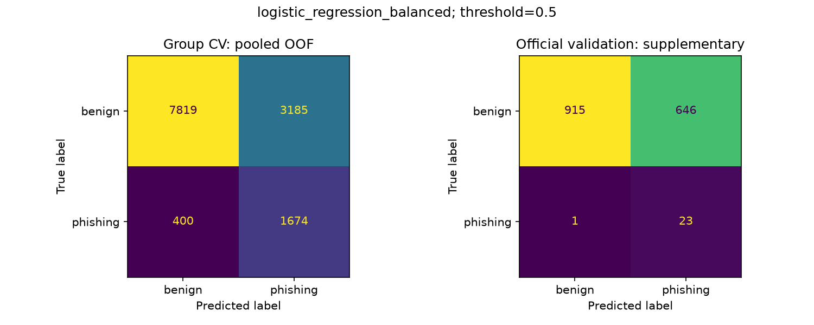
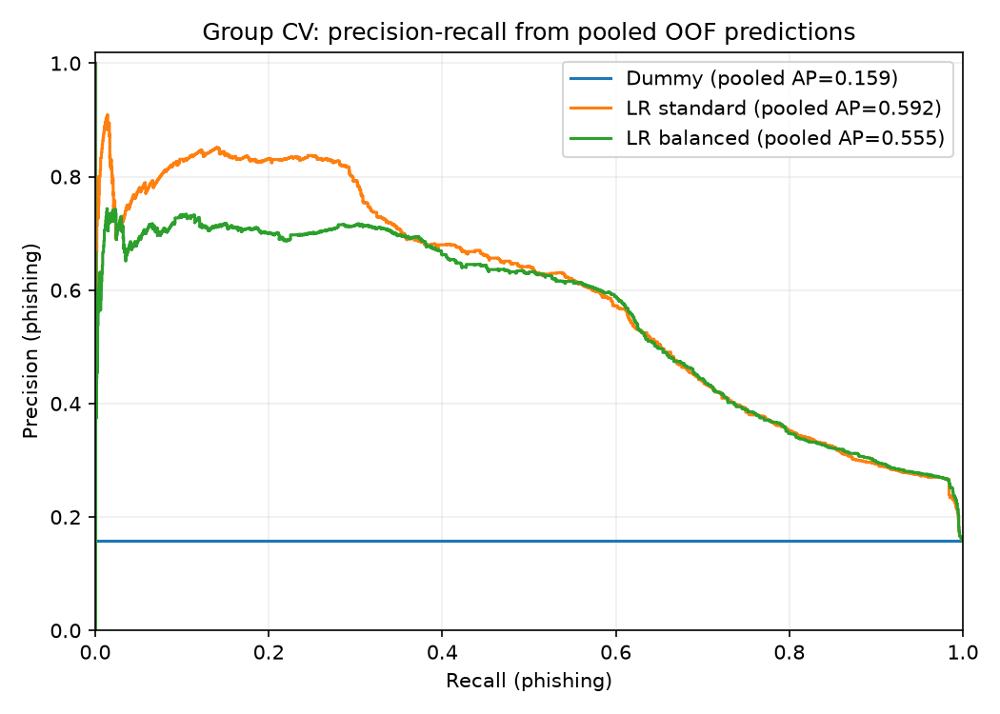

# Week 4 - E1 baseline

PR-AUC = average precision; phishing = 1.

## Evaluation

Core train: 13078 rows; phishing: 2074.
Official validation: 1585 rows; phishing: 24.
3 fixed domain folds supplied by Hung; scaler fitted only inside each training fold.
Fixed decision threshold: 0.5.
Official test was not predicted or scored.

## Group CV (mean +/- sample standard deviation)

| Configuration | Precision | Recall | F1 | AP |
|---|---:|---:|---:|---:|
| dummy_most_frequent | 0.0000 +/- 0.0000 | 0.0000 +/- 0.0000 | 0.0000 +/- 0.0000 | 0.1586 +/- 0.0001 |
| logistic_regression | 0.7300 +/- 0.0294 | 0.3269 +/- 0.0454 | 0.4500 +/- 0.0431 | 0.5942 +/- 0.0158 |
| logistic_regression_balanced | 0.3449 +/- 0.0125 | 0.8071 +/- 0.0089 | 0.4831 +/- 0.0107 | 0.5577 +/- 0.0155 |

Selected LR configuration: **logistic_regression_balanced**.
Selection uses mean CV phishing F1, with CV AP as tie breaker. No selection uses official validation.
Dummy is a reference; standard and balanced LR are two configurations of the same algorithm.

## Supplementary official validation

| Configuration | Precision | Recall | F1 | AP | FP | FN |
|---|---:|---:|---:|---:|---:|---:|
| dummy_most_frequent | 0.0000 | 0.0000 | 0.0000 | 0.0151 | 0 | 24 |
| logistic_regression | 0.2553 | 0.5000 | 0.3380 | 0.2933 | 35 | 12 |
| logistic_regression_balanced | 0.0344 | 0.9583 | 0.0664 | 0.2744 | 646 | 1 |

Selected model CV false-positive rate: 28.94%.
This saved model is an experimental baseline, not a final deployment choice.
Validation contains 24 phishing samples; interpret metrics with their class supports and source composition.
Scores are model outputs, not calibrated real-world risk probabilities.
Labels retain the anti-fraud/abuse scope and uncertainty of PhishVN.
Excluded from X/CV: 2 core rows; the original core is preserved and excluded IDs are recorded in the handoff.

## Outputs

- reports/tables/04_cv_metrics.csv and 04_cv_summary.csv
- reports/tables/04_validation_metrics.csv, 04_error_examples.csv and 04_run_metadata.json
- data/interim/04_cv_predictions.csv and 04_validation_predictions.csv (ignored)
- models/week4_lr_baseline.joblib and metadata JSON (ignored)

## Error analysis

The CSV contains up to five false positives and five false negatives from the selected model's OOF predictions.
TODO(Phuc): inspect original URLs by id and record observations/hypotheses; no labels were changed.
Manual notes in 04_error_examples.csv survive reruns; 04_error_notes.csv automatically archives notes for examples not currently selected.

Reproduce: python scripts/train_baseline.py (from the project environment).

