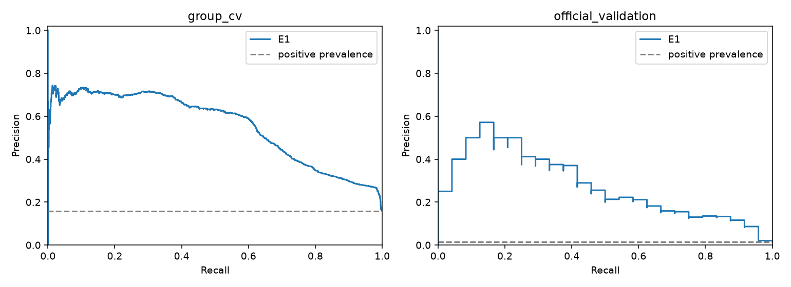
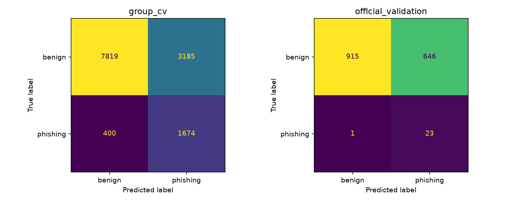
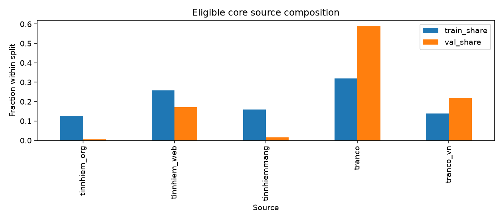
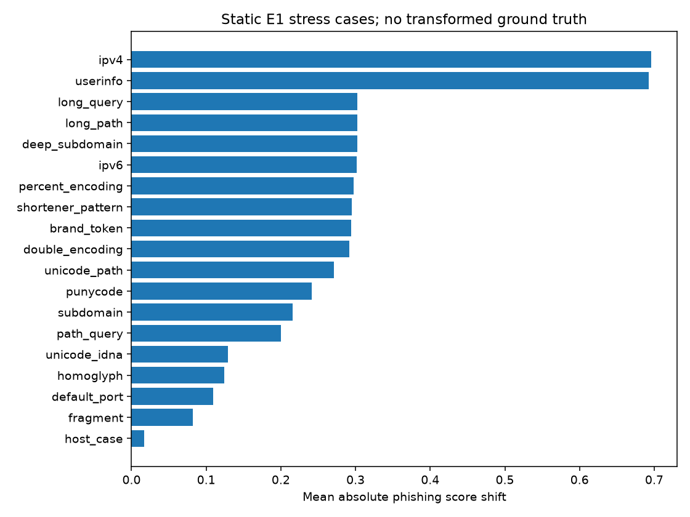

# PhishGuardVN — Week 5 evaluation (Hưng)

## Status and provenance

H5.1 DONE; H5.2 DONE for reproducible static review (human semantic checks pending); H5.3 DONE. H5.4 PREPARED for E2 and KD; actual E2 audit BLOCKED until producer artifacts arrive.

GitHub PRs #1–#4 verified merged on 2026-10-31. Local checkout initially d5555da; fetched and switched to detached merged main 3e9001c, preserving the original branch. No commits, pushes or merges performed. No Week-5 plan found in the checkout; scope follows the supplied H5.1–H5.4 request.

Runtime base revision: `3e9001cac54f5027637e713c2d5f65d130bb17e3`. Exact input/source hashes, versions, cache fingerprint and prediction/model hashes: tables/week5/run_manifest.json. This is a fresh reconstruction via merged `run_baseline`, not a claim that an unavailable Week-4 model was recovered. Original archived Week-4 tables were not overwritten.

12 lexical features; 13,078 eligible core train IDs; 3 unchanged domain folds; seed=42; scaler fit separately on each fitting fold; threshold=0.5. Two unresolved train/phishing URLs remain in the raw dataset, excluded with reasons. No official test features or predictions generated. Metadata (including source/tier) stays outside X.

Selected E1: **logistic_regression_balanced** by existing mean-CV-F1 rule, AP tie-break. Reconstructed predictions cover every eligible ID once per model/partition and pass label/fold/group/threshold checks. All available local Week-4 feature/domain/fold handoffs match by ID.

## H5.1 — measured evaluation

PR-AUC below means average precision (AP). Pooled OOF AP is a separate calculation from mean per-fold AP; AP depends on prevalence. P/R/F1 refer to phishing=1. Undefined recall/F1/AP in zero-positive strata remain missing.

| model | evaluation_partition | n_rows | n_phishing | tn | fp | fn | tp | precision_phishing | recall_phishing | f1_phishing | pr_auc | false_positive_rate | fp_per_1000_benign |
|---|---|---|---|---|---|---|---|---|---|---|---|---|---|
| dummy_most_frequent | group_cv | 13078 | 2074 | 11004 | 0 | 2074 | 0 | 0.0000 | 0.0000 | 0.0000 | 0.1586 | 0.0000 | 0.0000 |
| dummy_most_frequent | official_validation | 1585 | 24 | 1561 | 0 | 24 | 0 | 0.0000 | 0.0000 | 0.0000 | 0.0151 | 0.0000 | 0.0000 |
| logistic_regression | group_cv | 13078 | 2074 | 10751 | 253 | 1396 | 678 | 0.7282 | 0.3269 | 0.4512 | 0.5923 | 0.0230 | 22.9916 |
| logistic_regression | official_validation | 1585 | 24 | 1526 | 35 | 12 | 12 | 0.2553 | 0.5000 | 0.3380 | 0.2933 | 0.0224 | 22.4215 |
| logistic_regression_balanced | group_cv | 13078 | 2074 | 7819 | 3185 | 400 | 1674 | 0.3445 | 0.8071 | 0.4829 | 0.5552 | 0.2894 | 289.4402 |
| logistic_regression_balanced | official_validation | 1585 | 24 | 915 | 646 | 1 | 23 | 0.0344 | 0.9583 | 0.0664 | 0.2744 | 0.4138 | 413.8373 |

Mean and sample standard deviation across three folds (descriptive; not a confidence interval):

| model | pr_auc_mean | pr_auc_std | f1_phishing_mean | f1_phishing_std | recall_phishing_mean | recall_phishing_std | false_positive_rate_mean | false_positive_rate_std |
|---|---|---|---|---|---|---|---|---|
| dummy_most_frequent | 0.1586 | 0.0001 | 0.0000 | 0.0000 | 0.0000 | 0.0000 | 0.0000 | 0.0000 |
| logistic_regression | 0.5940 | 0.0158 | 0.4500 | 0.0431 | 0.3269 | 0.0454 | 0.0230 | 0.0053 |
| logistic_regression_balanced | 0.5576 | 0.0155 | 0.4831 | 0.0107 | 0.8071 | 0.0089 | 0.2894 | 0.0194 |

Archived Week-4 comparison: identical confusion counts=True; maximum absolute per-fold AP difference=0.000202656. Current runtime versions differ from the archived environment; the AP difference is recorded, not silently replaced by old metrics or attributed to a verified cause. See archived_e1_comparison.csv.

Observation: selected E1 pooled OOF FPR=28.94% (289.4 FP/1,000 benign), recall=80.71%; validation FPR=41.38%, recall=95.83%. Validation has only 24 positives; one case changes recall by 4.17 percentage points.

Strata tables include every fold, source, tier, fixed URL-length/entropy bin and domain, with supports/confusion counts. Domain strata are sparse and often single-class: no ranking as causal error mechanisms. They are diagnostics, never features or a validation tuning signal.

### Distribution/source shift

| dimension | stratum | train_n | val_n | train_share | val_share | share_delta_val_minus_train |
|---|---|---|---|---|---|---|
| source | tinnhiem_org | 1659 | 9 | 0.1269 | 0.0057 | -0.1212 |
| source | tinnhiem_web | 3362 | 271 | 0.2571 | 0.1710 | -0.0861 |
| source | tinnhiemmang | 2074 | 24 | 0.1586 | 0.0151 | -0.1434 |
| source | tranco | 4170 | 935 | 0.3189 | 0.5899 | 0.2710 |
| source | tranco_vn | 1813 | 346 | 0.1386 | 0.2183 | 0.0797 |
| tier | gold | 6638 | 280 | 0.5076 | 0.1767 | -0.3309 |
| tier | silver | 6440 | 1305 | 0.4924 | 0.8233 | 0.3309 |
| label | benign | 11004 | 1561 | 0.8414 | 0.9849 | 0.1434 |
| label | phishing | 2074 | 24 | 0.1586 | 0.0151 | -0.1434 |

| split | url_len_mean | url_len_median | url_len_min | url_len_max | entropy_mean | entropy_median | entropy_min | entropy_max |
|---|---|---|---|---|---|---|---|---|
| train | 17.1143 | 15.0000 | 4.0000 | 70.0000 | 3.2788 | 3.3232 | 1.4591 | 4.1724 |
| val | 13.7577 | 13.0000 | 5.0000 | 36.0000 | 3.2007 | 3.2389 | 1.9183 | 4.1035 |

Numerical summaries are descriptive across eligible IDs; group dependence and source-label confounding prevent causal or iid significance claims.

Khiêm's unmerged source audit reviewed at `79423ee721dc34d7ce8ca0ecf268c0282014eb82`; frozen file links/hashes and local corroboration are in [source audit review](tables/week5/source_audit_review.json). All five eligible sources are single-label; within-source class effects cannot be identified from this population. Source dependence is observed; model shortcut causality remains unverified. Producer hostname-presence checks differ from Hy PSL-resolved group eligibility. Two unresolved-domain Train positives remain excluded from E1; hostname presence is not sufficient for domain grouping. Datasheet v1 and proposed 150-300 candidate plan available; no actual reviewed/labeled pilot dataset found on this branch.

Testable hypotheses (unverified):

1. Prevalence/source composition explains part of the precision/AP gap. Check train OOF per-source and per-class supports; use a predeclared prevalence reweighting sensitivity analysis, then independently collected labeled data. Do not tune to official validation.
2. Sparse path/query coverage in train limits stability on complex URLs. Compare train-only nested-group CV errors across fixed complexity bins and a separately labeled static challenge set; current unlabeled flips cannot verify errors.
3. Domain lexical patterns interact with single-label sources. Use source-held-out diagnostics where both classes are supported and matched-length/entropy train OOF comparisons; lack of source class overlap makes some effects unidentifiable.
4. IDNA/brand cues add information beyond 12 lexical features. Compare E2 with E1 on exactly the same outer folds and an independent predeclared reference list; audit reference fitting before interpreting gains.

## H5.2 — manual error analysis

40 FP/FN cases selected using seed=42, SHA256-ranked IDs, round robin across partition/fold/type/source/tier and then distinct domains within queues. No ranking by score; selection is a diversity sample, not a population estimate. Sampling pool, coverage and limitations are recorded; if a stratum has no errors it contributes no cases.

| evaluation_partition | fold_id | outcome | cases |
|---|---|---|---|
| group_cv | 0.0000 | FN | 4 |
| group_cv | 0.0000 | FP | 8 |
| group_cv | 1.0000 | FN | 4 |
| group_cv | 1.0000 | FP | 8 |
| group_cv | 2.0000 | FN | 4 |
| group_cv | 2.0000 | FP | 7 |
| official_validation | undefined | FN | 1 |
| official_validation | undefined | FP | 4 |

| category | definition | sample_cases | interpretation |
|---|---|---|---|
| brand_cues | Visible generic brand-like tokens; no proof of impersonation | 2 | multi-label sample cue count, not population frequency |
| domain_subdomain | Multiple subdomain labels | 6 | multi-label sample cue count, not population frequency |
| lexical_patterns | Digits, hyphens, or action tokens in the string | 5 | multi-label sample cue count, not population frequency |
| url_complexity | Long URL, path or query | 0 | multi-label sample cue count, not population frequency |
| idna_ip | Unicode, punycode or IP literal | 0 | multi-label sample cue count, not population frequency |
| source_effects | Source-label confounding is a population hypothesis | 0 | multi-label sample cue count, not population frequency |
| label_uncertainty | Dataset label retained; semantic confirmation pending | 0 | multi-label sample cue count, not population frequency |
| unknown | No selected static cue; mechanism undetermined | 30 | multi-label sample cue count, not population frequency |

Each case has static observations, an explicitly unverified hypothesis, offline next verification, original labels and review status. Safe URL text is fully defanged and prefixed to prevent spreadsheet formulas; no suspicious URL was visited. Source effects and label uncertainty have explicit review fields; zero direct cue counts do not assert absence of those phenomena. No model output verifies a label error or individual causal mechanism.

Case-level annotations: tables/week5/error_cases.csv; pool: error_sampling_pool.csv; taxonomy: error_taxonomy.csv. Human semantic verification remains pending; original labels are retained.

## H5.3 — static robustness

144 static cases; expected parser-validity checks passed 144/144. Full results/specifications and limitations: [robustness report](week5_robustness.md).

No transformed ground truth, accuracy or F1. Prediction flips are sensitivity findings, not established model errors. Expected malformed rejection is a successful validity check.

## H5.4 — E2 audit and KD readiness

PREPARED / experimental audit BLOCKED: no E2 manifest supplied. Await Hy's features/dictionary/references and Phúc's predictions/configs/lineage/candidates; Khiêm's bias/pilot evidence is optional for core paired evaluation.

Loaders/adapters enforce artifact hashes, exact feature order/dictionary, eligible IDs, fixed folds, finite values, lexical-contract consistency, fold-local or independent external brand references, producer training-ID lineage and matched E1/E2 comparisons. Producer declarations still need code/reference review; schema checks alone do not prove leakage absence. Synthetic fixtures validate logic only and contribute no reported experimental metrics.

[KD evaluation protocol](../docs/kd_evaluation_protocol.md); [handoff and continuation prompt](../docs/week5_hung_handoff.md). Optional source-bias/pilot evidence from Khiêm remains separate from X; source bias is not claimed resolved.
