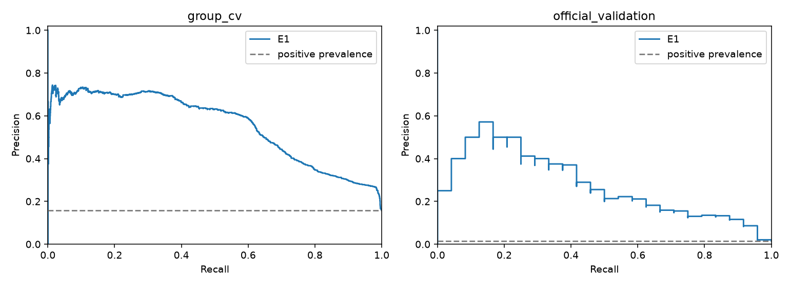
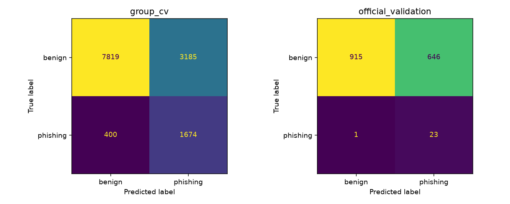
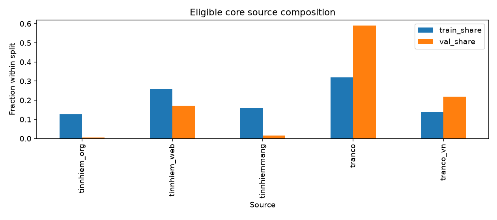
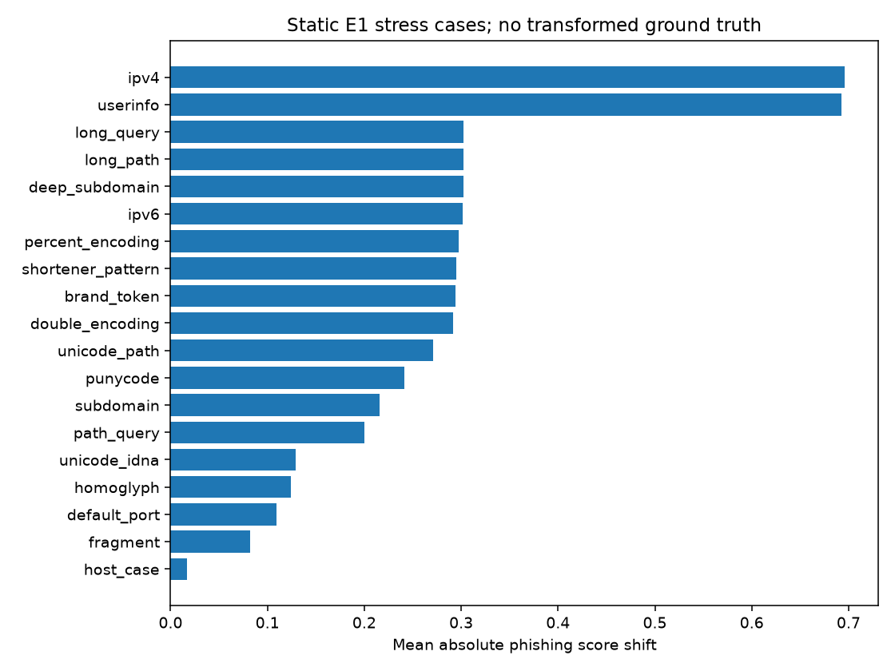

# PhishGuardVN — Week 5 evaluation (Hưng)

## Status and provenance

H5.1 DONE; H5.2 OFFLINE REVIEW DONE / HUMAN REVIEW PENDING; H5.3 DONE. H5.4 FEATURE AUDIT DONE / PRELIMINARY; MODEL AUDIT DONE / PASS / PRELIMINARY. E2_ROBUSTNESS_PENDING_MODEL_ARTIFACT. KD PROTOCOL PREPARED.

Upstream snapshot at runtime: `06526d63614747e903715b9737016415b4088435` on week5/hung-evaluation-robustness. Current audit runtime base: `06526d63614747e903715b9737016415b4088435`; original E1 generation base: `3e9001cac54f5027637e713c2d5f65d130bb17e3`. Runtime source state: `modified_from_head`. Source/config/annotation hashes identify the working sources; a later publication commit does not retroactively change this runtime capture. Main/PR #5 integration and publication history are recorded in the handoff.

Exact input/source hashes, versions, analysis fingerprint, immutable E1 generation provenance and artifact hashes: tables/week5/run_manifest.json. E1 cache reuse checks actual dataset, training-source/config/environment and model/lineage hashes; analysis/report changes do not force retraining. Original archived Week-4 tables are unchanged.

12 lexical features; 13,078 eligible core train IDs; 3 unchanged domain folds; seed=42; scaler fit separately on each fitting fold; threshold=0.5. Two unresolved train/phishing URLs remain in the raw dataset, excluded with reasons. No official test features or predictions generated. Metadata (including source/tier) stays outside X.

Selected E1: **logistic_regression_balanced** by existing mean-CV-F1 rule, AP tie-break. Reconstructed predictions cover every eligible ID once per model/partition and pass label/fold/group/threshold checks. All available local Week-4 feature/domain/fold handoffs match by ID.

## H5.1 — measured evaluation

PR-AUC below means average precision (AP). Pooled OOF AP is a separate calculation from mean per-fold AP; AP depends on prevalence. P/R/F1 refer to phishing=1. Undefined recall/F1/AP in zero-positive strata remain missing.

| model | evaluation_partition | n_rows | n_phishing | tn | fp | fn | tp | precision_phishing | recall_phishing | f1_phishing | pr_auc | false_positive_rate | fp_per_1000_benign |
|---|---|---|---|---|---|---|---|---|---|---|---|---|---|
| dummy_most_frequent | group_cv | 13078 | 2074 | 11004 | 0 | 2074 | 0 | 0.0000 | 0.0000 | 0.0000 | 0.1586 | 0.0000 | 0.0000 |
| dummy_most_frequent | official_validation | 1585 | 24 | 1561 | 0 | 24 | 0 | 0.0000 | 0.0000 | 0.0000 | 0.0151 | 0.0000 | 0.0000 |
| logistic_regression | group_cv | 13078 | 2074 | 10751 | 253 | 1396 | 678 | 0.7282 | 0.3269 | 0.4512 | 0.5923 | 0.0230 | 22.9916 |
| logistic_regression | official_validation | 1585 | 24 | 1526 | 35 | 12 | 12 | 0.2553 | 0.5000 | 0.3380 | 0.2933 | 0.0224 | 22.4215 |
| logistic_regression_balanced | group_cv | 13078 | 2074 | 7819 | 3185 | 400 | 1674 | 0.3445 | 0.8071 | 0.4829 | 0.5552 | 0.2894 | 289.4402 |
| logistic_regression_balanced | official_validation | 1585 | 24 | 915 | 646 | 1 | 23 | 0.0344 | 0.9583 | 0.0664 | 0.2744 | 0.4138 | 413.8373 |

Mean and sample standard deviation across three folds (descriptive; not a confidence interval):

| model | pr_auc_mean | pr_auc_std | f1_phishing_mean | f1_phishing_std | recall_phishing_mean | recall_phishing_std | false_positive_rate_mean | false_positive_rate_std |
|---|---|---|---|---|---|---|---|---|
| dummy_most_frequent | 0.1586 | 0.0001 | 0.0000 | 0.0000 | 0.0000 | 0.0000 | 0.0000 | 0.0000 |
| logistic_regression | 0.5940 | 0.0158 | 0.4500 | 0.0431 | 0.3269 | 0.0454 | 0.0230 | 0.0053 |
| logistic_regression_balanced | 0.5576 | 0.0155 | 0.4831 | 0.0107 | 0.8071 | 0.0089 | 0.2894 | 0.0194 |

Archived Week-4 comparison: identical confusion counts=True; maximum absolute per-fold AP difference=0.000202656. Current runtime versions differ from the archived environment; the AP difference is recorded, not silently replaced by old metrics or attributed to a verified cause. See archived_e1_comparison.csv.

Observation: selected E1 pooled OOF FPR=28.94% (289.4 FP/1,000 benign), recall=80.71%; validation FPR=41.38%, recall=95.83%. Validation has only 24 positives; one case changes recall by 4.17 percentage points.

Strata tables include every fold, source, tier, fixed URL-length/entropy bin and domain, with supports/confusion counts. Domain strata are sparse and often single-class: no ranking as causal error mechanisms. They are diagnostics, never features or a validation tuning signal.

### Distribution/source shift

| dimension | stratum | train_n | val_n | train_share | val_share | share_delta_val_minus_train |
|---|---|---|---|---|---|---|
| source | tinnhiem_org | 1659 | 9 | 0.1269 | 0.0057 | -0.1212 |
| source | tinnhiem_web | 3362 | 271 | 0.2571 | 0.1710 | -0.0861 |
| source | tinnhiemmang | 2074 | 24 | 0.1586 | 0.0151 | -0.1434 |
| source | tranco | 4170 | 935 | 0.3189 | 0.5899 | 0.2710 |
| source | tranco_vn | 1813 | 346 | 0.1386 | 0.2183 | 0.0797 |
| tier | gold | 6638 | 280 | 0.5076 | 0.1767 | -0.3309 |
| tier | silver | 6440 | 1305 | 0.4924 | 0.8233 | 0.3309 |
| label | benign | 11004 | 1561 | 0.8414 | 0.9849 | 0.1434 |
| label | phishing | 2074 | 24 | 0.1586 | 0.0151 | -0.1434 |

| split | url_len_mean | url_len_median | url_len_min | url_len_max | entropy_mean | entropy_median | entropy_min | entropy_max |
|---|---|---|---|---|---|---|---|---|
| train | 17.1143 | 15.0000 | 4.0000 | 70.0000 | 3.2788 | 3.3232 | 1.4591 | 4.1724 |
| val | 13.7577 | 13.0000 | 5.0000 | 36.0000 | 3.2007 | 3.2389 | 1.9183 | 4.1035 |

Numerical summaries are descriptive across eligible IDs; group dependence and source-label confounding prevent causal or iid significance claims.

Khiêm's unmerged source audit reviewed at `79423ee721dc34d7ce8ca0ecf268c0282014eb82`; frozen file links/hashes and local corroboration are in [source audit review](tables/week5/source_audit_review.json). All five eligible sources are single-label; within-source class effects cannot be identified from this population. Source dependence is observed; model shortcut causality remains unverified. Producer hostname-presence checks differ from Hy PSL-resolved group eligibility. Two unresolved-domain Train positives remain excluded from E1; hostname presence is not sufficient for domain grouping. Datasheet v1 and proposed 150-300 candidate plan available; no actual reviewed/labeled pilot dataset found on this branch.

Testable hypotheses (unverified):

1. Prevalence/source composition explains part of the precision/AP gap. Check train OOF per-source and per-class supports; use a predeclared prevalence reweighting sensitivity analysis, then independently collected labeled data. Do not tune to official validation.
2. Sparse path/query coverage in train limits stability on complex URLs. Compare train-only nested-group CV errors across fixed complexity bins and a separately labeled static challenge set; current unlabeled flips cannot verify errors.
3. Domain lexical patterns interact with single-label sources. Use source-held-out diagnostics where both classes are supported and matched-length/entropy train OOF comparisons; lack of source class overlap makes some effects unidentifiable.
4. IDNA/brand cues add information beyond 12 lexical features. Compare E2 with E1 on exactly the same outer folds and an independent predeclared reference list; audit reference fitting before interpreting gains.

## H5.2 — manual error analysis

40 FP/FN cases selected using seed=42, SHA256-ranked IDs, round robin across partition/fold/type/source/tier and then distinct domains within queues. No ranking by score; selection is a diversity sample, not a population estimate. Sampling pool, coverage and limitations are recorded; if a stratum has no errors it contributes no cases.

| evaluation_partition | fold_id | outcome | cases |
|---|---|---|---|
| group_cv | 0.0000 | FN | 4 |
| group_cv | 0.0000 | FP | 8 |
| group_cv | 1.0000 | FN | 4 |
| group_cv | 1.0000 | FP | 8 |
| group_cv | 2.0000 | FN | 4 |
| group_cv | 2.0000 | FP | 7 |
| official_validation | undefined | FN | 1 |
| official_validation | undefined | FP | 4 |

| category | definition | sample_cases | interpretation |
|---|---|---|---|
| brand_cues | Visible generic brand-like tokens; no proof of impersonation | 3 | multi-label sample cue count, not population frequency |
| domain_subdomain | Multiple subdomain labels | 6 | multi-label sample cue count, not population frequency |
| lexical_patterns | Digits, hyphens, or action tokens in the string | 5 | multi-label sample cue count, not population frequency |
| url_complexity | Long URL, path or query | 0 | multi-label sample cue count, not population frequency |
| idna_ip | Unicode, punycode or IP literal | 0 | multi-label sample cue count, not population frequency |
| source_effects | Source-label confounding is a population hypothesis | 0 | multi-label sample cue count, not population frequency |
| label_uncertainty | Dataset label retained; semantic confirmation pending | 0 | multi-label sample cue count, not population frequency |
| unknown | No selected static cue; mechanism undetermined | 0 | multi-label sample cue count, not population frequency |
| bare_host_lexical_ambiguity | Bare hostname; aggregate counts do not encode token meaning or categorical suffix identity | 34 | multi-label sample cue count, not population frequency |
| representation_collision | Identical full lexical vector in fitting data has the opposite original label; tolerance 1e-12 | 30 | multi-label sample cue count, not population frequency |
| near_threshold | Observed score within 0.05 of the fixed 0.5 threshold; descriptive only | 22 | multi-label sample cue count, not population frequency |
| subdomain_count_sensitivity | Observed subdomain/dot structure; exact model terms inspected, semantics unverified | 6 | multi-label sample cue count, not population frequency |

Each case has static observations, an explicitly unverified hypothesis, offline next verification, original labels and review status. Safe URL text is fully defanged and prefixed to prevent spreadsheet formulas; no suspicious URL was visited. Source effects and label uncertainty have explicit review fields; zero direct cue counts do not assert absence of those phenomena. No model output verifies a label error or individual causal mechanism.

All 40 cases now have case-specific offline engineering notes, preserved read-only in [durable annotations](annotations/week5_error_reviews.json). Case signatures bind notes to ID, context, original label, URL, score and all 12 features; changed evidence fails as stale instead of silently reusing a review. Taxonomy describes observed representations, not verified root causes; all human semantic verification remains pending.

Exact correct-context LR arithmetic is verified for every case. Opposite-label full-vector collisions in fitting data are observed for 30/40 cases (absolute feature tolerance 1e-12). The selected model is refitted only in its three existing fitting folds for explanation when those models are unavailable; no new model selection, thresholds or baseline experiments are introduced. Validation explanations use the original full-Train pipeline. Contributions are relative to each fitting mean, with correlated dot/subdomain/length terms often cancelling; they are not independent causal effects.

Evidence: error_model_evidence.csv (reconstructed logits/scores, fitting-ID hashes and collision supports) and error_feature_attributions.csv (all 12 raw/scaled terms per case). Collision searches use fitting IDs only, not held-out labels. The coarse representation can be ambiguous under original labels, but this does not verify maliciousness, label correctness or a source shortcut.

Case-level annotations: tables/week5/error_cases.csv; pool: error_sampling_pool.csv; taxonomy: error_taxonomy.csv. Human semantic verification remains pending; original labels are retained.

Hưng must directly review at least 30 cases using [human checklist](annotations/week5_human_review.csv), alongside the existing case observations and evidence tables. Suggested review order covers every partition/fold/FP-FN stratum before repeating a stratum; the first 30 span all of them. Case-specific observations, unverified hypotheses and exact fitting-context evidence accompany each row. Human reviewer/date/checks/notes/status are preserved on regeneration. Current notes originate from Codex offline engineering analysis; no human sign-off is inferred from this file or from a model score.

## H5.3 — static robustness

144 static cases; expected parser-validity checks passed 144/144. Full results/specifications and limitations: [robustness report](week5_robustness.md).

No transformed ground truth, accuracy or F1. Prediction flips are sensitivity findings, not established model errors. Expected malformed rejection is a successful validity check.

## H5.4 — E2 audit and KD readiness

H5.4 FEATURE AUDIT DONE / PRELIMINARY; MODEL AUDIT DONE / PASS / PRELIMINARY. E2_ROBUSTNESS_PENDING_MODEL_ARTIFACT. KD PROTOCOL PREPARED.

Native Hy feature audit: **PASS / PRELIMINARY**; 14663 rows, 20 features, split counts {'train': {'x': 13078, 'excluded': 2}, 'val': {'x': 1585, 'excluded': 0}}; excluded=2. Reference SHA256 `32198c1734bacd23263eae979465e22d95c2038bfa63cb2107fdbe8cd115f1cf`, statuses={'draft': 37}. [Checks and provenance](tables/week5/e2_feature_audit.json). Draft reference provenance remains pending Hy review; this is not frozen E2 v1.

**Native model audit PASS / PRELIMINARY**, producer commit `b230fd6ebe33d43b8bd64d2b83653d546156fe1a`, protocol `week5_e1_e2_readable_v1`, schema `e2-brand-v0`. Rows: {'oof': 130780, 'validation': 15850, 'training_partitions': 52312}. IDs, labels and outer folds match Hưng's canonical eligible Train/Validation data. All four fitting contexts and their two seeded inner domain folds were reconstructed without model fitting; no held-out/Validation/Test IDs enter fitting or tuning records.

Recomputed 30 outer-fold metrics, 10 Validation rows, 10 mean/sample-SD summaries and 15 paired-fold comparisons. Maximum absolute discrepancy against Phúc's tables: 2.22e-16. AP uses original ranking scores; SVM uses signed decision_function with boundary 0, other models use class-1 probabilities with estimator.predict boundary 0.5. No sigmoid, threshold tuning or changes to H5.1 E1.

Mean outer AP ± sample SD, F1 and FPR (proportions), paired by model:

| model | pr_auc_mean_e1 | pr_auc_std_e1 | pr_auc_mean_e2 | pr_auc_std_e2 | f1_phishing_mean_e1 | f1_phishing_mean_e2 | false_positive_rate_mean_e1 | false_positive_rate_mean_e2 |
|---|---|---|---|---|---|---|---|---|
| hist_gradient_boosting | 0.6979 | 0.0226 | 0.7224 | 0.0173 | 0.6066 | 0.6272 | 0.0201 | 0.0192 |
| logistic_regression | 0.5942 | 0.0158 | 0.6417 | 0.0046 | 0.4500 | 0.4944 | 0.0230 | 0.0227 |
| logistic_regression_balanced | 0.5577 | 0.0155 | 0.6306 | 0.0124 | 0.4831 | 0.5439 | 0.2894 | 0.1828 |
| mlp | 0.6992 | 0.0140 | 0.7335 | 0.0142 | 0.5989 | 0.6315 | 0.0232 | 0.0176 |
| svm_rbf | 0.6426 | 0.0318 | 0.6545 | 0.0420 | 0.5596 | 0.5961 | 0.0145 | 0.0155 |

Teacher shortlist rederived exclusively from Train CV: ['E2__mlp', 'E2__hist_gradient_boosting']. All 15 paired AP/F1 deltas are positive. Shortlist fold details below; all models are in [paired folds](tables/week5/e2_paired_folds.csv). HistGB has one additional FP in each of folds 0 and 2 despite lower mean FPR; MLP recall declines in fold 1. Three correlated folds and one seed support descriptive comparisons, not formal significance or independent-population confidence intervals.

| model | fold_id | pr_auc_e1 | pr_auc_e2 | delta_pr_auc | delta_f1_phishing | delta_recall_phishing | delta_false_positive_rate |
|---|---|---|---|---|---|---|---|
| hist_gradient_boosting | 0 | 0.7070 | 0.7261 | 0.0191 | 0.0219 | 0.0260 | 0.0003 |
| hist_gradient_boosting | 1 | 0.7146 | 0.7376 | 0.0230 | 0.0249 | 0.0217 | -0.0033 |
| hist_gradient_boosting | 2 | 0.6721 | 0.7035 | 0.0314 | 0.0152 | 0.0173 | 0.0003 |
| mlp | 0 | 0.7153 | 0.7322 | 0.0169 | 0.0191 | 0.0116 | -0.0046 |
| mlp | 1 | 0.6929 | 0.7200 | 0.0271 | 0.0110 | -0.0116 | -0.0104 |
| mlp | 2 | 0.6894 | 0.7482 | 0.0588 | 0.0676 | 0.0708 | -0.0016 |

Supplementary untouched Validation (24 phishing positives): both shortlisted E2 models have lower AP than E1, even while fixed-boundary F1 improves. AP depends on full ranking and prevalence; F1 measures one operating point, so these outcomes can coexist. Source-label confounding and Train/Validation shift limit generalization; the draft 37-brand reference limits feature claims. Do not select/tune models, thresholds or references using these Validation findings.

| candidate | pr_auc | f1_phishing | tn | fp | fn | tp |
|---|---|---|---|---|---|---|
| E1__hist_gradient_boosting | 0.4338 | 0.4062 | 1534 | 27 | 11 | 13 |
| E1__mlp | 0.4314 | 0.3288 | 1524 | 37 | 12 | 12 |
| E2__hist_gradient_boosting | 0.4278 | 0.4590 | 1538 | 23 | 10 | 14 |
| E2__mlp | 0.3762 | 0.3824 | 1530 | 31 | 11 | 13 |

Producer runtime base `a4f8a1892237c3d9b3c1bb2a3243928b453744bd` (dirty=True) differs from the published artifact commit above. Exact compressed/metadata/table hashes, code/reference LF hashes and producer versions are recorded in run_manifest.json → native_model_audit. Raw producer input hashes are retained, without claiming byte equality to regenerated local files; normalized LF reference/source content matches. [Independent PR review](https://github.com/phuctran33/PhishGuardVN/pull/6#pullrequestreview-5766640293) covers committed fitting/selection code; prediction records alone cannot prove original execution or reference independence.

**E2_ROBUSTNESS_PENDING_MODEL_ARTIFACT**: no fitted E2 MLP/HistGB bundle or matching local predictor was delivered in either checkout's models/artifact directories. Phúc must supply trusted fitted preprocessing+model weights, SHA256, training commit/config, exact 20-feature order/schema, embedded reference snapshot/hash and extractor hashes, plus class order/score semantics. Then reuse the existing 144-case suite. Native inference code alone is insufficient; no E2 or KD training was performed.

The handoff records the producer branch/metadata reviewed for this run. Advanced models using lexical_12 must not be relabeled as 20-feature E2 results. Model comparison requires actual matched E2 OOF/Validation predictions, declared score kind/decision rule, fitting/preprocessing/tuning lineage and reference/version hashes. No producer model is trained by this audit.

Loaders/adapters enforce artifact hashes, exact feature order/dictionary, eligible IDs, fixed folds, finite values, lexical-contract consistency, fold-local or independent external brand references, producer training-ID lineage and matched E1/E2 comparisons. Producer declarations still need code/reference review; schema checks alone do not prove leakage absence. Synthetic fixtures validate logic only and contribute no reported experimental metrics.

The optional generic model-bundle adapter remains probability-only; the native Phúc adapter separately validates actual probability/margin semantics and recorded estimator.predict labels. AP accepts ranking margins. H5.1 E1 remains at 0.5; Validation/Test never select an operating point. Synthetic test fixtures supply no experimental results.

[KD evaluation protocol](../docs/kd_evaluation_protocol.md); [handoff and continuation prompt](../docs/week5_hung_handoff.md). Optional source-bias/pilot evidence from Khiêm remains separate from X; source bias is not claimed resolved.
