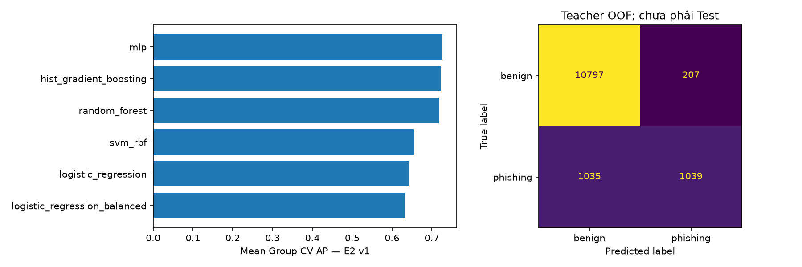

# Phúc — hoàn thành Teacher v1 tuần 6

Phần thực hiện trên nhánh phuc-week6-teacher-v1, từ main 5509ed1. Code huấn luyện nằm trong [notebook 06](../notebooks/06_teacher_v1.ipynb). Không thu thập thêm URL, đổi nhãn/folds/reference hoặc đánh giá Official Test.

## Kết quả bàn giao

Teacher được chọn: **MLP, E2 v1, 20 features**, chỉ fit 13.078 eligible Train URLs. Model có 44135 bytes (43.10 KiB), gồm pipeline và reference snapshot. Không phải Teacher v0 được đổi tên.

- Model: [week6_teacher_v1.joblib](../models/week6_teacher_v1.joblib).
- Script dự đoán: [predict_teacher.py](../scripts/predict_teacher.py).
- Thông tin lựa chọn/version/hash: [teacher_selection.json](tables/week6/teacher_selection.json).
- Quyết định khóa trước external: [week6_teacher_lock.json](../configs/week6_teacher_lock.json).
- Hướng dẫn bàn giao/đọc code: [week6_phuc_handoff.md](../docs/week6_phuc_handoff.md).

Teacher ở đây là model chốt cho bước tiếp theo của đồ án. Chưa làm KD/soft targets hoặc xác nhận hiệu quả triển khai thực tế.

## 1. Dữ liệu và cách chọn

E2 v1 dùng 12 lexical + 8 brand features, reference có 45 brand verified theo tài liệu nhóm. Ma trận được tạo lại bằng script chính thức, chỉ Train+Validation; đối chiếu ID/schema/finite/reference/dictionary/splits và 12 cột lexical khớp E1. Hai unresolved giữ ngoài X như trước. Không dùng metadata/label/source làm feature.

Giữ đúng ba outer domain folds của Hưng, seed 42. Trong mỗi outer fitting, hai inner group folds chọn tham số bằng AP. Scaler nằm trong Pipeline; MLP/HistGB không dùng random validation early stopping. Model lỗi hội tụ sẽ dừng, không âm thầm công bố fit chưa hội tụ.

Các mốc: LR thường, LR balanced, SVM RBF, MLP, HistGB. Ứng viên mới: Random Forest 200 cây, min_samples_leaf=2, class_weight=balanced, max_depth thử 12/None. Grid khai báo trước external, mỗi họ tối đa hai cấu hình; không thêm grid sau khi xem holdout.

**Chọn mean outer AP cao nhất**, hòa thì F1 cao hơn, FPR thấp hơn rồi tên. AP là average_precision_score; tên cột pr_auc giữ theo repo, không phải accuracy hay diện tích PR tính bằng hình thang. SVM dùng margin, ranh giới 0; các model khác dùng predict_proba để xếp hạng và predict mặc định, ranh giới 0,5. Không tune ngưỡng.

## 2. Bảng so sánh E2 v1

| Model | CV AP | Recall | FPR | F1 | p50 ms/batch 128 | Pipeline KiB |
| --- | --- | --- | --- | --- | --- | --- |
| mlp | 0.7264 | 50.10% | 1.88% | 0.6259 | 1.420 | 35.84 |
| hist_gradient_boosting | 0.7230 | 50.68% | 2.00% | 0.6279 | 4.324 | 143.55 |
| random_forest | 0.7176 | 73.09% | 17.07% | 0.5557 | 29.347 | 5275.26 |
| svm_rbf | 0.6547 | 46.29% | 1.56% | 0.5990 | 43.633 | 531.14 |
| logistic_regression | 0.6432 | 36.84% | 2.28% | 0.4942 | 1.602 | 2.44 |
| logistic_regression_balanced | 0.6327 | 74.35% | 19.24% | 0.5390 | 1.326 | 2.45 |

AP/F1/Recall/FPR là trung bình ba outer folds. Độ trễ là p50 PC predict + score cho **batch 128** trên X đã tính, một thread, 5 warm-up + 30 lần đo; kích thước pipeline chưa gồm reference. Số đo local chỉ tham khảo, không phải latency điện thoại hoặc thời gian URL → kết quả đầy đủ.

Vì sao chọn MLP:
- AP 0,7264 cao nhất theo tiêu chí đã chốt; cao hơn HistGB 0,7230 khoảng 0,0033.
- Model gọn; FPR khoảng 1,88% ở ngưỡng cố định. HistGB có F1/Recall nhỉnh hơn một chút, nên không gọi MLP tốt hơn ở mọi chỉ số.
- Random Forest có Recall 73,09% nhưng FPR 17,07%; LR balanced tương tự có FPR cao. Recall tăng đi kèm nhiều cảnh báo nhầm, không đủ để chọn.
- Ba folds có phần training chồng lấp; AP MLP std khoảng 0,0174. Chênh lệch nhỏ chưa chứng minh ưu thế có ý nghĩa thống kê.
- Recall MLP mới khoảng 50,10%; model còn bỏ sót nhiều phishing, chưa được quảng bá là bảo vệ hoàn chỉnh.

Cấu hình MLP cuối trên toàn Train:

~~~text
{"model__hidden_layer_sizes": [32]}
~~~

Cùng StandardScaler; alpha=0.001, batch_size=256, max_iter=1000, early_stopping=False, n_iter_no_change=20, random_state=42. Chi tiết cấu hình theo từng fold trong parameters.csv.

## 3. Validation bổ sung

| model | pr_auc | recall_phishing | false_positive_rate | f1_phishing | fp | fn |
| --- | --- | --- | --- | --- | --- | --- |
| logistic_regression | 0.3489 | 0.5417 | 0.0205 | 0.3768 | 32 | 11 |
| logistic_regression_balanced | 0.3102 | 0.9583 | 0.2556 | 0.1031 | 399 | 1 |
| svm_rbf | 0.2448 | 0.5000 | 0.0141 | 0.4138 | 22 | 12 |
| mlp | 0.3931 | 0.5000 | 0.0231 | 0.3333 | 36 | 12 |
| hist_gradient_boosting | 0.4473 | 0.5833 | 0.0147 | 0.4590 | 23 | 10 |
| random_forest | 0.3854 | 0.9583 | 0.2787 | 0.0954 | 435 | 1 |

Validation có 1.585 URL và chỉ 24 phishing. MLP có AP 0,3931, TP=12, FN=12, FP=36; HistGB có AP 0,4473. Không dùng kết quả này đổi Teacher đã chọn bằng Train CV. AP không đồng nghĩa F1 tại một ngưỡng; prevalence/source/domain khác nhau và số positive ít hạn chế kết luận. Chưa chấm Official Test.

## 4. Phân tích 12 lỗi OOF thật

[errors.csv](tables/week6/errors.csv) có 12 ID khác nhau: hai FP và hai FN ở mỗi fold, chọn theo thứ tự ID cố định. Đây là mẫu để đọc lỗi, không phải mẫu ngẫu nhiên đại diện tỷ lệ lỗi toàn bộ.

Mỗi dòng có observation/hypothesis/next_check. Quan sát tính offline từ X và fitting partition tương ứng; giả thuyết không phải chứng minh nguyên nhân hoặc xác minh nhãn website. Không dùng model full Train để giải thích kết quả OOF như thể đó là model đã dự đoán từng fold.

| URL defanged | Fold | Error | Score | Fitting opposite-label same-vector |
| --- | --- | --- | --- | --- |
| kokatrade[.]com | 0 | FN | 0.1347 | 67 |
| mrhmfund[.]com | 0 | FN | 0.1380 | 25 |
| vn-inc[.]info | 2 | FN | 0.3329 | 0 |
| b1dv[.]xyz | 1 | FN | 0.1940 | 0 |
| pos365[.]vn | 0 | FP | 0.6022 | 5 |
| masothue[.]biz | 1 | FN | 0.1261 | 18 |
| pinuian[.]top | 2 | FN | 0.1646 | 39 |
| 11478[.]com | 2 | FP | 0.6257 | 0 |
| vnpayment[.]vn | 1 | FP | 0.9837 | 0 |
| 24hstore[.]vn | 0 | FP | 0.6429 | 3 |
| https://www[.]paypal[.]com | 1 | FP | 0.8817 | 4 |
| h-chan[.]me | 2 | FP | 0.9201 | 28 |

Giải thích các con số và bước kiểm tra:
- “Trùng vector trái nhãn” đếm fitting URLs có cùng 20 số E2 (atol=1e-12) nhưng nhãn đối lập với case. Các chuỗi khác nhau có thể có cùng độ dài/count/entropy/brand flags. Đây là giới hạn biểu diễn, không có nghĩa đã phát hiện URL trùng hoặc nhãn sai.
- kokatrade/mrhmfund/masothue/pinuian không bật brand; cùng vector với nhiều benign trong fitting. Cần đối chiếu biểu diễn/nguồn thay vì chỉ tăng độ phức tạp model.
- b1dv bật homoglyph_brand_hit=1 theo key BIDV sau folding, nhưng vẫn FN. Một flag không ép mạng neural phải đoán phishing; xem các feature cùng nhau và độ thưa của tín hiệu.
- pos365/24hstore có chữ số nhưng nhãn benign; chữ số tự nó không chứng minh độc hại.
- vnpayment được matcher ghi nhận key vnpay trong vnpayment, mismatch=1 và token payment. Nên nhờ Hy đối chiếu alias/domain chính thức; chưa kết luận chỉ một flag gây FP, không tự thêm whitelist vì nhìn nhãn holdout.
- paypal không bật tám brand features trong reference v1 hiện tại; tính thưa/phạm vi reference có thể hạn chế biểu diễn. Hệ thống chưa dùng danh sách allowlist để tự trả benign.
- 11478/h-chan cho thấy chuỗi ngắn/nhiều số/gạch ngang có thể bị cảnh báo nhầm. Cần đối chiếu fitting tương ứng, không chỉnh rule để khớp riêng 12 ví dụ.

## 5. External host-only, tách khỏi chọn Teacher

Dùng đúng 167 candidates đã có (138 phishing, 29 benign), không crawl thêm. Với cả hai lớp, input là hostname chuẩn hóa, giữ subdomain, bỏ scheme/port/path/query/fragment. Không thêm URL đầy đủ giả cho phishing hostname.

Hai CSV nguồn vẫn pending; ledger sau audit có 99 verified theo tài liệu hostname lịch sử (92 phishing/7 benign), 68 pending. Hưng có xác nhận human check riêng theo ID/signature; không sửa ngược method/reviewer trong ledger và không coi đây là live-site verification.

Teacher/threshold đã khóa bằng Core Train CV **trước** các lời gọi external. Không train, tune hoặc chọn lại model theo số dưới.

- Pilot phishing: **62 TP / 30 FN / 92** → Recall **67,39%**.
- Phép thử hai lớp chỉ exploratory: 99 mẫu → TP=62, FN=30, FP=1, TN=6.
- FPR 1/7 = 14,29% có mẫu số rất nhỏ; một benign đổi kết quả 14,29 điểm phần trăm. Không dùng precision/F1/accuracy ở tập lệch này để khẳng định hiệu quả thực tế.
- 68 pending không tham gia bất kỳ metric nào. Có dự đoán tham khảo đủ 167 trong external_all_predictions.csv, cột candidate_label giữ rõ là nhãn ứng viên.
- Kết quả chính theo nguồn:

| source | n | tp | fn | recall_phishing |
| --- | --- | --- | --- | --- |
| ACB official list of fake websites | 37 | 35 | 2 | 94.59% |
| Agribank official warning of spoofed domains | 2 | 1 | 1 | 50.00% |
| BIDV official consumer fraud warning | 4 | 4 | 0 | 100.00% |
| Bac Ninh government local public-service scam alert | 1 | 1 | 0 | 100.00% |
| NCSC warning republished by Dak Lak government | 36 | 14 | 22 | 38.89% |
| NCSC weekly scam warnings on Ministry portal | 1 | 0 | 1 | 0.00% |
| Quang Ngai police publication of NCSC warning | 10 | 6 | 4 | 60.00% |
| VNCERT/CC warning on Ministry portal | 1 | 1 | 0 | 100.00% |

Nhóm cảnh báo ACB có 35/37 TP, nhưng bản đăng cảnh báo NCSC tại Đắk Lắk chỉ 14/36. Nhiều nhóm còn 1–4 mẫu, không diễn giải 100% là tổng quát tốt. Source–label confounding, quan hệ giữa các bản đăng lại, phạm vi lịch sử/host-only và tuyển chọn không ngẫu nhiên vẫn còn.

Chi tiết: [external_results.json](tables/week6/external_results.json), external_verified_predictions.csv. Không gộp kết quả external vào Train CV/Validation.

## 6. Cách dùng lại và giới hạn phiên bản

~~~powershell
.\.venv\Scripts\python.exe scripts/predict_teacher.py --examples
.\.venv\Scripts\python.exe scripts/predict_teacher.py "https://example.com/login"
~~~

Đã thử năm URL offline. Score chưa hiệu chuẩn thành tỷ lệ bị lừa; URL lỗi trả lỗi parser, không tự gán benign. Web/mobile có thể gọi API Python dùng model này. Joblib không chạy trực tiếp trên điện thoại; offline mobile còn cần thử chuyển đổi/runtime và đối chiếu cùng 20 feature/reference bằng parity cases của Hy. Chưa tuyên bố đã export hay benchmark điện thoại.

Artifact chỉ khoảng 44 KB nên cho phép quản lý riêng Teacher này trong Git. Các model tuần 5 và cache khác vẫn theo quy tắc cũ. Với cùng dependencies, Hưng/Hy nhận model + lock + source là có thể predict, không cần tải dataset để gọi inference.

Nếu tái tạo: chạy train_teacher.py sau khi có bốn handoff tuần 4 và E2 trainval v1. Các bảng/lock/model tuần 6 sẽ được ghi lại; cần đọc lại báo cáo nếu grid/data đổi. Đầu ra tuần 5 được giữ nguyên.

## 7. Kiểm chứng và phần không gộp vào nhiệm vụ

- Notebook thật: 12/12 code cells chạy không lỗi.
- Test suite: 391 passed, 1 skipped; skip cũ do tập tham số rỗng ở test_brand_regressions.py.
- Bốn tests mới chạy code cell thật: v0 bị chặn; scaler/tuning trong fitting; đáp án outer holdout không đổi dự đoán của fold đó; Validation không đổi CV/chọn Teacher.
- Kiểm tra bổ sung artifact/load/CLI/hash/metric và bảo toàn đầu ra cũ ghi trong verification.json.
- Manifest local E2 được tái tạo khi nhánh đang sửa nên frozen=false/git_dirty=true; schema/reference v1 được giữ nguyên, không giả bản build sạch. Runtime revision và hash code/input ghi theo thực tế.
- Lỗi guard của verifier freeze E2 trên main đã được ghi tại post_merge_eda_review.md: nó xét thay đổi toàn repo nên có thể từ chối docs/code tuần mới. Không sửa manifest, bỏ hash guard hoặc gọi tất cả verifier đã pass trong phần Teacher này.

### Kết quả verifier cũ trên máy Windows hiện tại

Lần kiểm tra trước commit chạy script nguyên trạng: 33/37 mục PASS, 4 FAIL và 1 thông báo SKIP ma trận all chưa có. Bốn FAIL gồm: working tree chưa commit; hai guard so toàn repo với commit freeze cũ; so sánh parity đòi bằng nhau tuyệt đối. Phép đối chiếu riêng 47 parity cases và các giá trị tính tay đã đạt: chỉ 24 giá trị entropy khác ở mức sai số số thực, tối đa 1,78e-15, nhỏ hơn tolerance 1e-6 của bộ parity. Không thay fixture/manifest/verifier để che kết quả này. Phần kiểm toán số và model bàn giao của tuần 6 đã pass, nhưng không tuyên bố verifier cũ PASS toàn bộ.

Benchmark status trong thư mục external_pilot là snapshot bàn giao K5.3 trước khi có Teacher. Kết quả inference mới của phần Phúc nằm riêng tại reports/tables/week6/external_results.json; không ghi đè lịch sử audit của Hưng/Khiêm.
