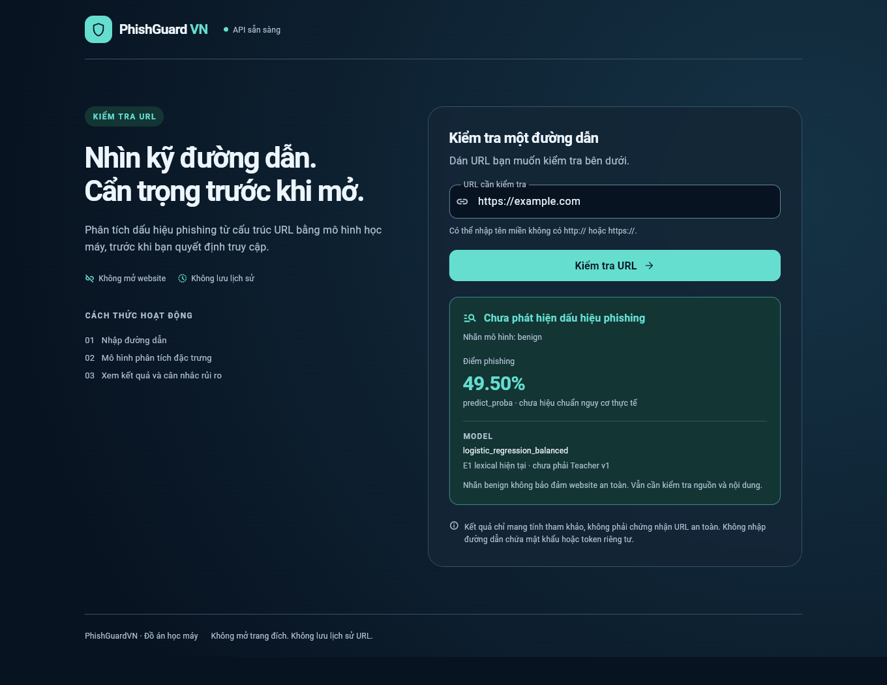
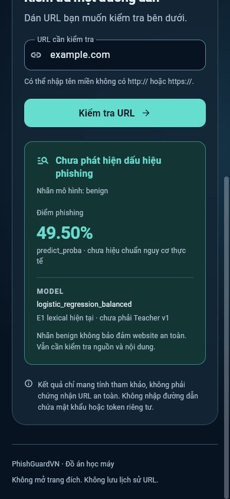
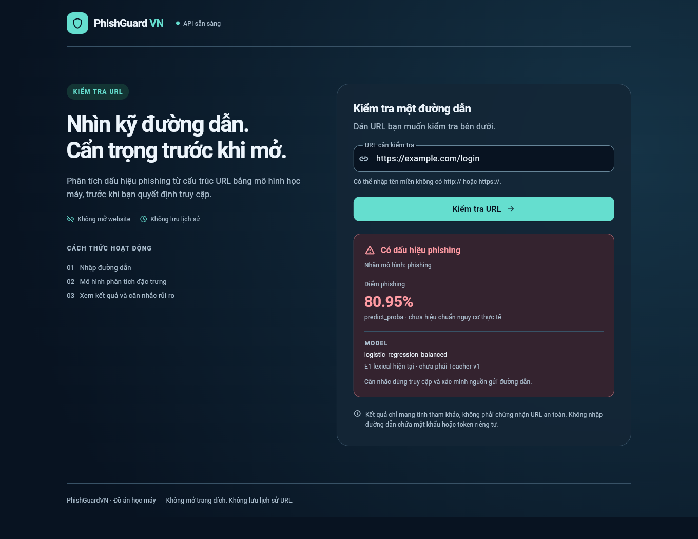
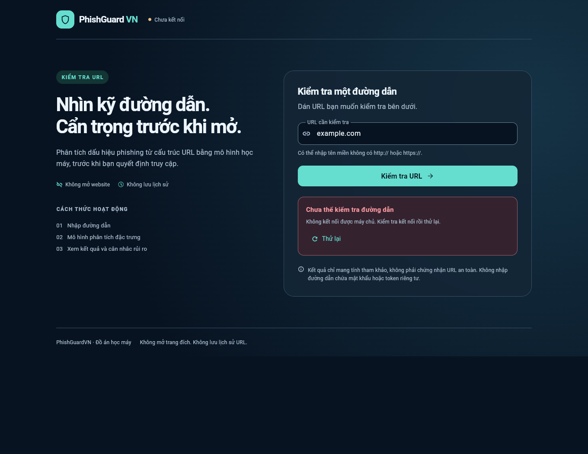

# Week 6 — Flutter Web #19 và E2E với model thật

Web là PR riêng, stacked trên backend [PR #22](https://github.com/phuctran33/PhishGuardVN/pull/22), base commit `509e6a3`. Chỉ thêm `apps/web/`, README/bằng chứng Web; không đưa lại backend vào diff PR Web. Không tự merge hoặc đóng #19 khi bước tích hợp Teacher chưa được chứng minh.

## Thiết kế đã triển khai

Đã cài **UI UX Pro Max CLI 2.15.0** từ repository chính thức và `uipro init --ai codex --global`. Skill ở `~/.agents/skills/ui-ux-pro-max`; đã đọc SKILL.md và chạy workflow tạo/persist design system cùng truy vấn style/Flutter thật. CLI yêu cầu restart assistant để tự discovery; phiên này đọc và chạy thủ công thành công, không nhận rằng Codex đã tự reload skill.

[Design system đã áp dụng](../apps/web/design-system/phishguardvn/MASTER.md): Glassmorphism tiết chế, dark navy/cyan-teal/red, bố cục Minimalism / Swiss, Flutter Material 3; một card blur 12px, font Roboto local, hierarchy/spacing rõ, không dữ liệu dashboard giả hoặc animation trang trí. Gợi ý Cyberpunk ban đầu được loại vì không khớp brief; palette/light-mode generic được thay bằng yêu cầu của người dùng. API #15 đã chốt/push trước phần thiết kế; Web không sửa contract hoặc inference.

## Kết quả chạy thật

| Kiểm tra | Kết quả |
|---|---|
| Flutter 3.47.9 / Dart 3.13.7, `flutter analyze` | No issues found |
| `flutter test` | **19 passed**, 0 skipped, 0 failed; gồm client/schema/timeout và widget loading/error/retry, score probability/margin, mobile 320×844 không overflow và kết quả trong viewport; thêm phishing đỏ, chữ 200%/reduced motion và contrast |
| `flutter build web --release --no-web-resources-cdn --dart-define=API_BASE_URL=http://127.0.0.1:8000` | Thành công; assets/fonts/CanvasKit phục vụ local |
| Chrome thật headless, Flutter release → FastAPI → pipeline E1 thật | **9/9 nhóm tình huống PASS**, 0 page errors, không route mocking hoặc synthetic predictions |
| Backend từ clone mới qua GitHub, venv mới theo README | **33 backend tests passed in 2.36s**; health/docs 200, chưa có model trả degraded/503 |
| Swagger UI trong Chrome | Render đủ 2 operations: health và predict |

Client/unit/widget tests dùng fixtures synthetic chỉ để kiểm tra protocol và trạng thái, không dùng fixtures trong demo/browser acceptance. Toàn bộ Python suite của backend trước Web: **420 passed, 1 skip cũ, 1 SyntaxWarning cũ**; xem [báo cáo API](week6_api_verification.md). Không nhận đây là toàn bộ QA/security/CI/latency của Khiêm (#17).

## E2E tối thiểu và kết quả

Browser mở `http://127.0.0.1:3000`, API `http://127.0.0.1:8000`; input URL chỉ nằm trong POST body, không mở trang example.com hoặc URL người dùng. Các request của trang trong lượt desktop chỉ tới `127.0.0.1` (assets local và API).

| Trường hợp | Bằng chứng quan sát |
|---|---|
| URL hợp lệ `https://example.com` | HTTP 200, benign, logistic_regression_balanced, probability `0.4949721386878221`; UI hiển thị **49.50% predict_proba chưa hiệu chuẩn**, không bảo đảm an toàn |
| Nhánh phishing UI `https://example.com/login` | HTTP 200, model trả phishing, score `0.809465335516596`; UI đỏ + icon + nhãn + hướng dẫn. Đây là URL ví dụ dành riêng để thử nhánh UI, không phải website đã xác minh độc hại |
| URL rỗng | Form báo thiếu URL, số POST không tăng |
| URL thiếu scheme `example.com` | HTTP 200; score khớp cùng pipeline, parser backend xử lý scheme thiếu |
| URL sai port `http://example.com:99999` | HTTP 422/invalid_port, error card và retry, input vẫn chỉnh được |
| Backend mất kết nối | Dừng thật tiến trình API bằng SIGTERM; UI hiện lỗi kết nối và trạng thái chưa kết nối, không trả prediction giả |
| Thử lại sau restart | Khởi động lại API với cùng artifact thật, bấm Thử lại trên **cùng trang**, kết quả phục hồi mà không reload |
| Mobile 390×844 | HTTP 200 và model/score thật; kết quả tự cuộn vào viewport, không document horizontal overflow |

Bổ sung 6 viewport: **320×844, 375×812, 844×390, 768×1024, 1024×768, 1440×900**. Mỗi viewport gọi API thật, gửi bằng Enter, bật reduced motion, thấy score và không document horizontal overflow. Widget test riêng kiểm tra **200% text ở 320px**, không overflow; kiểm tra luminance cho text ≥4.5:1 trên các surface và input outline ≥3:1. Đây là các kiểm tra accessibility có phạm vi cụ thể, không nhận là audit WCAG đầy đủ.

Mobile là viewport emulation trên Chrome, **không** nhận là kiểm thử trên điện thoại Android thật; Android/parity thuộc Hy. Với Flutter, live-region text có thể là label của semantic group; automation kiểm tra đúng accessibility node và nội dung render, không chỉ tìm một text node rời. Ảnh được xem lại để đối chiếu hiển thị thực.

JSON của lượt chạy thành công, artifact SHA và screenshot hashes: [web_smoke.json](tables/week6/web_smoke.json).

## Ảnh demo thực tế

Đây là screenshots browser thật, không phải mockup hoặc ảnh sinh. Không có video được nhận là đã quay; các bước trong README cho phép tự quay lại demo.

## Model và bước còn chờ #16

Model hiện tại: cache H5.1 **logistic_regression_balanced / lexical_12**, protocol `week5_e1_audit`, artifact SHA256 `6bd8324a56bba9f98615599419349947f461f77d6a9e11f578db22836dd6014c`. Không clone/fit/tune/change weights; raw data, labels, splits/folds, extractor, reference, notebook outputs, experiment metrics và file model đều giữ nguyên. Scores ở trên là kiểm tra endpoint trên input kỹ thuật, **không phải** external benchmark/quality metric.

Chưa có Teacher E2 v1 từ Phúc trong môi trường bàn giao: checkbox “tích hợp Teacher v1” của #19 vẫn **PENDING/BLOCKED #16**. Backend đã có guard E2 v1/order/reference/source hashes; khi có artifact đúng, chỉ đổi cấu hình backend và restart, frontend không sửa contract hoặc gọi mọi score là xác suất. Không thay v0 thành v1 hoặc tự train để làm demo.

## Bảo toàn kết quả nghiên cứu

Đối chiếu SHA256 **267 file gốc** tại base `5509ed1`: **265 không đổi**, chỉ README và pyproject.toml thay đổi để hướng dẫn/cài API. Raw data, labels, splits, folds, feature code/reference, notebooks/outputs, model bytes và kết quả thí nghiệm không đổi. Artifact E1 giữ SHA256 ở trên; diff Web so với branch backend không có thay đổi `src/`, Python tests, pyproject hoặc API contract. Không truy cập URL đích, train/tune hoặc dùng Official Test.

## Chạy và bàn giao hậu kiểm

Xem [apps/web/README.md](../apps/web/README.md) cho cài từ máy mới, config/CORS, test/build và 5 bước smoke để Khiêm thực hiện sau bàn giao #19. [API contract](../docs/api_contract.md) vẫn v1, đủ request/response/error codes; không thay endpoint hoặc semantics trong PR Web.

Để dùng máy hiện tại: code Web ở `/tmp/PhishGuardVN-w6-web`; API backend ở `/tmp/PhishGuardVN-w6-api`. Model local nằm ngoài các worktree này và phải cấu hình bằng đường dẫn thật. Bản chạy kiểm chứng dùng web port 3000/API 8000; không phải deployment production hay URL công khai. CI/security/latency đầy đủ và nghiệm thu chung trước 15/11 vẫn theo #17, không đánh dấu hoàn thành thay Khiêm.
