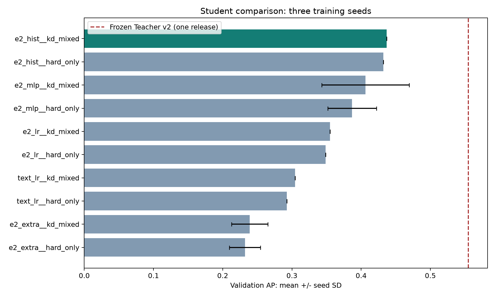
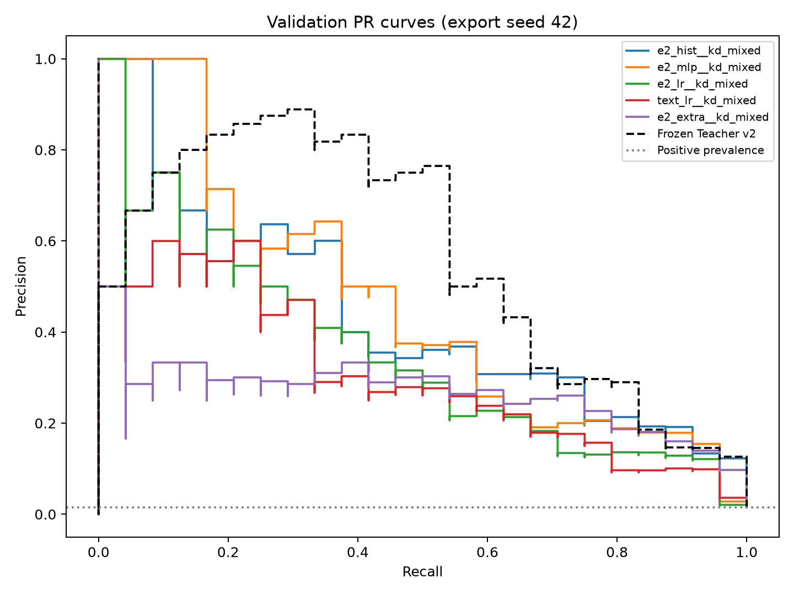
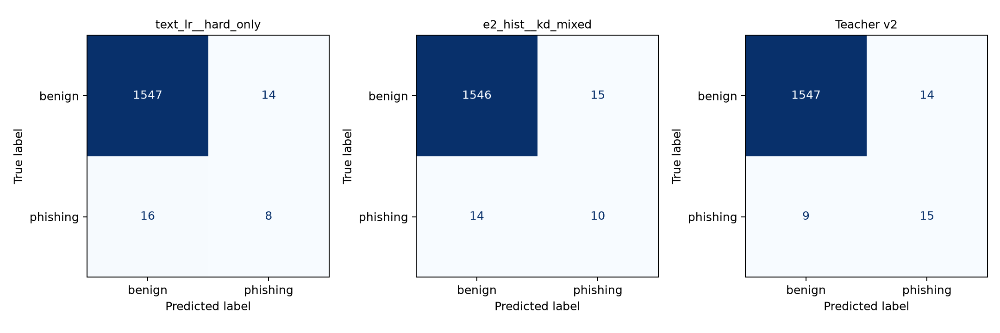
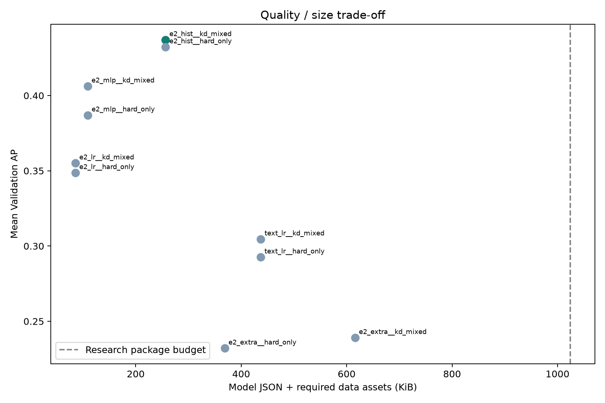
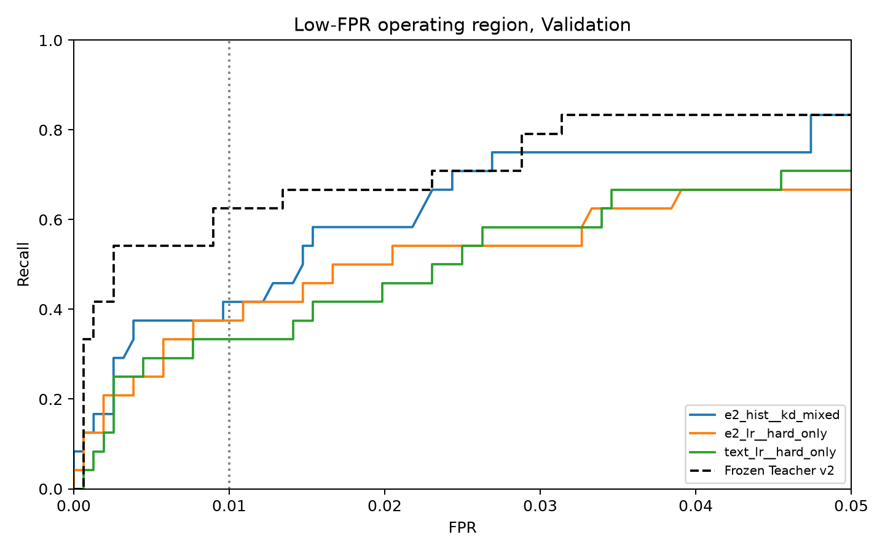
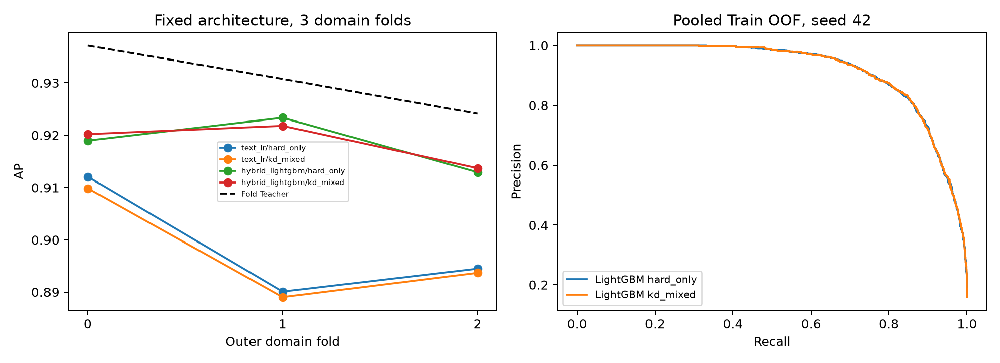

# Teacher–Student tuần 7 — baseline, so sánh, LightGBM và quyết định

> Notebook thống nhất: 07_student.ipynb. Phần 1–6 là khảo sát Validation ban đầu; phần LightGBM dùng Group CV riêng. Không trộn hai protocol.
**Đây là nghiên cứu phát triển trên Validation, chưa phải final evaluation hoặc Android release.**
Kế hoạch cấu hình được commit trước fitting; không sửa Teacher, E2, reference, targets hay baseline cũ.
Căn cứ: [protocol](../docs/week7_student_comparison_protocol.md).

## 1. Phạm vi đã chạy

- 5 họ × 2 cách học × 3 seed = **30 fits**, không grid hoặc chọn seed đẹp.
- Train 13.078; Validation 1.585, chỉ **24 phishing**. Cùng IDs/targets giữa mọi mô hình.
- Bản cũ text LR được chạy lại làm đối chứng. E2 LR tách tác dụng đổi input khỏi đổi thuật toán.
- MLP 32–16, HistGB 150 vòng/7 lá và Extra Trees 64 cây/sâu 8 là các cấu hình nhỏ đã chốt.
- Hard-only và KD đều dùng weighted BCE; alpha=0,5. Không tune alpha sau khi thấy số liệu.
- Artifacts là seed 42 đã định trước; không dùng seed có AP tốt nhất.
- Mean/SD phản ánh biến động training seed; không phải uncertainty từ ba dataset độc lập.

## 2. Bảng kết quả

| Candidate | AP mean ± SD | Recall mean | FPR mean | F1 mean | Data package KiB | Desktop p95 ms |
|---|---:|---:|---:|---:|---:|---:|
| e2_hist__kd_mixed | 0.4370 ± 0.0000 | 41.67% | 0.96% | 0.4082 | 256.7 | 1.428 |
| e2_hist__hard_only | 0.4322 ± 0.0000 | 37.50% | 0.96% | 0.3750 | 256.6 | 1.461 |
| e2_mlp__kd_mixed | 0.4062 ± 0.0631 | 38.89% | 0.96% | 0.3851 | 109.0 | 1.064 |
| e2_mlp__hard_only | 0.3870 ± 0.0351 | 37.50% | 0.94% | 0.3777 | 109.2 | 1.818 |
| e2_lr__kd_mixed | 0.3551 ± 0.0000 | 41.67% | 0.96% | 0.4082 | 85.9 | 0.972 |
| e2_lr__hard_only | 0.3487 ± 0.0000 | 37.50% | 0.96% | 0.3750 | 85.9 | 1.087 |
| text_lr__kd_mixed | 0.3046 ± 0.0000 | 33.33% | 0.83% | 0.3556 | 437.3 | 0.089 |
| text_lr__hard_only | 0.2926 ± 0.0000 | 33.33% | 0.90% | 0.3478 | 437.1 | 0.115 |
| e2_extra__kd_mixed | 0.2391 ± 0.0262 | 25.00% | 0.92% | 0.2674 | 616.2 | 1.582 |
| e2_extra__hard_only | 0.2321 ± 0.0225 | 26.39% | 0.96% | 0.2781 | 368.8 | 1.361 |

Teacher v2 trên cùng Validation: AP **0.5549**, Recall 62.50%, FPR 0.90%, TP/FP/TN/FN=15/14/1547/9.
Teacher giữ ngưỡng phát hành; Student dùng ngưỡng riêng chọn trên Validation. PR/Recall–FPR curves cho phép xem các operating points.

## 3. Candidate tốt nhất trong khảo sát Validation ban đầu

Chọn **e2_hist__kd_mixed** theo tiêu chí đã chốt: đạt budget, mean AP cao nhất; tie-break Recall rồi kích thước.
- AP mean **0.4370**, SD **0.0000**; so với text LR hard-only 0.2926 và E2 LR hard-only 0.3487.
- Artifact **176,786 bytes**; cộng PSL/reference cần thiết thành **262,825 bytes**; budget nghiên cứu là 1.048.576 bytes.
- Export seed 42: TP=10, FP=15, TN=1546, FN=14, threshold=0.52320722239282391.
- Desktop p50/p95: 1.092/1.428 ms, scope raw URL→score; không suy ra số đo Android.
- Đây là lựa chọn tốt nhất trong menu/cấu hình/budget đã thử. Không gọi là optimum toàn cục hoặc Student đã sẵn sàng triển khai.

Tác dụng của KD trong từng họ (cùng input/kiến trúc):

| Họ | AP hard | AP KD | KD − hard |
|---|---:|---:|---:|
| e2_hist | 0.4322 | 0.4370 | +0.0048 |
| e2_mlp | 0.3870 | 0.4062 | +0.0192 |
| e2_lr | 0.3487 | 0.3551 | +0.0064 |
| text_lr | 0.2926 | 0.3046 | +0.0120 |
| e2_extra | 0.2321 | 0.2391 | +0.0070 |

Không quy mọi cải thiện so với text LR thành lợi ích KD: đổi sang E2 và đổi kiến trúc cũng là thay đổi.
KD có thể không giúp một họ; bản hard-only tốt hơn vẫn được giữ và báo cáo.
Trong lượt này, HistGB hard-only đã đạt AP 0,4322; thêm KD chỉ tăng 0,0048. Phần lớn mức tăng so với text LR không đến từ riêng KD.
HistGB 150 vòng/7 lá học tương tác phi tuyến giữa các đặc trưng E2, thay cho một tầng linear trên ký tự. Đây là cấu hình Student mới, không lấy lại nhánh Teacher đã fit.
E2 LR KD cũng có Recall/FPR/F1 giống HistGB KD ở ngưỡng đã chọn, nhưng AP thấp hơn và package nhỏ hơn; nếu ưu tiên chi phí hơn AP, đây là đối án đáng xem.
MLP KD seed 42 có AP 0,4619, cao hơn HistGB, nhưng mean qua 3 seed chỉ 0,4062 và SD 0,0631; không lấy riêng seed đẹp để chọn.
SD bằng 0 của LR/HistGB trong cấu hình này chủ yếu do thuật toán xác định, không phải bằng chứng model ổn định trước dataset/source shift.

## 4. Uncertainty và chi phí

Paired bootstrap theo registrable domain Validation, 1.000 lần. Delta là mean AP qua seed, models đã fit; CI không điều chỉnh quá trình chọn winner:
- e2_hist__kd_mixed − e2_hist__hard_only: ΔAP=+0.0048, 95% CI [-0.0199, +0.0257], valid=1000, undefined=0.
- e2_hist__kd_mixed − text_lr__hard_only: ΔAP=+0.1445, 95% CI [-0.1087, +0.3662], valid=1000, undefined=0.

Các CI trên đều chứa 0: chưa có bằng chứng chắc chắn rằng cải thiện AP tổng quát là dương. Lựa chọn candidate là theo tiêu chí development đã chốt, không phải khẳng định thắng có ý nghĩa thống kê.

Cỡ package tính model JSON và dữ liệu PSL/reference bắt buộc, chưa gồm source/runtime/APK overhead.
E2 cần parser/feature extractor/reference; vector input 20 số không có nghĩa chi phí đầu-cuối bằng 0.
Latency là Python JSON reference trên desktop, có tách E2 extraction và inference trong latency.csv.
MLP chạy cố định 200 epochs; ConvergenceWarning được lưu trong runs.csv, không bị che và không được gọi là đã hội tụ.

## 5. Giới hạn và Go/No-Go

- Validation đã được xem và nay dùng chọn model/ngưỡng; mở rộng theo yêu cầu sau baseline là adaptive development.
- Chỉ 24 phishing, ba seeds, một cấu hình/họ. CI có điều kiện không xóa selection bias.
- Targets Teacher in-sample trên Train; không phải cross-fitted/OOF KD.
- Source × label còn confounded; domain split không chứng minh tổng quát tốt ngoài dataset.
- Chưa thử CNN/Transformer; không có kết luận chúng kém hơn menu hiện tại.
- Không đọc/chấm Official Test/external mới. Teacher không retrain; baseline Student cũ không ghi đè.
- JSON/sklearn parity trên 1.585 Validation samples mỗi exported model không phải Android parity.
- Chưa có số đo thiết bị/RAM/battery/APK; chưa chuyển engine mặc định.

**Khảo sát ban đầu:** HistGB KD là candidate đứng đầu menu này; kết quả giữ làm đối chiếu lịch sử.
**Engine hiện tại:** giữ Teacher stacking v2. Nhóm yêu cầu kiểm chứng thêm LightGBM bên dưới; Student không tự chuyển thành mặc định.

## 6. Tái chạy và bàn giao

Notebook 07_student.ipynb (đã gộp baseline và các thử nghiệm) có bảng/hình/output đã chạy.
scripts/compare_students.py chạy thí nghiệm; scripts/summarize_student_comparison.py chỉ đọc kết quả để tạo report/hình.
scripts/predict_student_comparison.py --examples dùng model đã xuất, không cần Teacher ở inference.
artifacts/student_comparison/manifest.json lưu selected_candidate, hash/version, parity và source revision.
Toàn bộ kết quả gồm các bản yếu đều nằm trong reports/tables/student_comparison/.

## 7. LightGBM theo yêu cầu nhóm: 3-fold Teacher–Student

Cấu hình: 400 trees, num_leaves=15, TF-IDF ký tự 8.192 + 20 E2. Chỉ thêm họ này, giữ LR làm baseline.
Hai mode dùng cùng objective cross_entropy: hard-only q=y, KD q=0,5*y+0,5*Teacher score, T=1.
Loss = -q*log(p)-(1-q)*log(1-p); LightGBM hỗ trợ trực tiếp fractional labels, không nhân đôi hàng.
Teacher CV là các bản stacking theo fold đã lưu: cùng kiến trúc/hyperparameters, weights khác release, không học held fold.
Đã kiểm fitting/held ID hashes, domain disjoint, fit ledger và tái hiện held predictions cũ; không fit lại Teacher.
Targets còn in-sample trong phần fitting; không gọi là inner cross-fit KD. Student cuối dùng targets released Teacher v2.
Vocabulary chỉ fit trong fitting partition của từng fold. Official splits và mapping 3 folds giữ nguyên.
CV báo tại threshold 0,5 cố định. Threshold xuất model lấy từ pooled Train Student OOF với FPR budget 1%, không chọn trên outer-held/Validation.
Dùng 3 seeds 42/43/44, export seed 42. Config deterministic, không subsample nên kết quả trùng seed; không coi đó là 9 independent tests.

| Họ | Mode | Mean fold AP | Seed SD | Recall CV | FPR CV | F1 CV |
|---|---|---:|---:|---:|---:|---:|
| hybrid_lightgbm | hard_only | 0.9184 | 0.0000 | 76.18% | 1.64% | 0.8242 |
| hybrid_lightgbm | kd_mixed | 0.9186 | 0.0000 | 76.28% | 1.65% | 0.8244 |
| text_lr | hard_only | 0.8989 | 0.0000 | 65.24% | 0.90% | 0.7674 |
| text_lr | kd_mixed | 0.8975 | 0.0000 | 65.33% | 0.95% | 0.7670 |

Teacher fold mean AP=0.9307; không trộn với Teacher Validation AP=0,5549.
Khác class prevalence và protocol nên không so trực tiếp CV AP ~0,92 với Validation AP ~0,65 để quy riêng thành overfit.

Mode chọn từ CV: **kd_mixed**. Chênh lệch mean-fold AP KD−hard rất nhỏ; pooled-OOF paired bootstrap ΔAP=+0.000154, 95% CI [-0.001079, +0.001341].
CI chứa 0: chưa có bằng chứng chắc chắn KD cải thiện ngoài mẫu. Mean-fold delta và pooled-OOF delta là hai đại lượng hơi khác nhau.

Validation bổ sung sau khi freeze (không chọn lại cấu hình/ngưỡng từ bảng này):

| Mode, seed 42 | AP | Recall | FPR | TP/FP/TN/FN | Threshold Train OOF |
|---|---:|---:|---:|---|---:|
| hard_only | 0.6223 | 54.17% | 0.64% | 13/10/1551/11 | 0.615718 |
| kd_mixed | 0.6549 | 54.17% | 0.64% | 13/10/1551/11 | 0.620450 |

LightGBM KD Validation AP=0,6549 cao hơn Teacher 0,5549; không che kết quả này. Tuy nhiên Student bắt 13/24, Teacher 15/24 tại ngưỡng tương ứng; Student có 10 FP so Teacher 14 FP.
Hai mode LightGBM có cùng confusion counts trên Validation ở ngưỡng đã freeze, dù thứ hạng score/AP khác.
Validation đã được xem trước trong đồ án; CV theo fold tách fitting hợp lệ nhưng reuse CV/adaptive research không phải final independent test.

Gói JSON + TF-IDF/IDF + reference + PSL: hard=1,248,939 bytes; KD=1,249,389 bytes. Vượt mục tiêu nghiên cứu 1 MiB; budget Android thật chưa được xác nhận.
Không giảm số cây/lá hoặc đổi cấu hình để ép vừa budget. File .model.txt là bản native bổ sung; không cộng cả hai định dạng vào một runtime package.
Đã xuất 58 static Python fixtures: 52 valid và 6 rejected; không có ground truth accuracy labels.
Model JSON được kiểm với native LightGBM trên toàn Validation và static fixtures. Chưa có Dart adapter/Android parity hoặc số đo latency/RAM/APK cho Student này.
Desktop end-to-end timings dưới đây dùng cùng 250 URLs sau 50 warm-ups, threads=1; Teacher dùng sklearn backend, Student dùng portable JSON. Đây là so sánh implementation, không suy ra Android speedup.

| Model | Backend | p50 ms | p95 ms |
|---|---|---:|---:|
| Teacher v2 | Python released sklearn | 5.274 | 7.849 |
| hard_only | Python portable JSON | 4.986 | 6.205 |
| kd_mixed | Python portable JSON | 4.975 | 6.112 |
Source targets/fit lineage, CV/Validation predictions, model, vocabulary/IDF, reference, PSL và SHA-256 được bàn giao trong repo.
Teacher targets trên Train đã khá sát nhãn thật: release Teacher mean score benign ~0,0177, phishing ~0,9343. Trộn alpha=0,5 cho mean q ~0,0089 và ~0,9671.
Vì vậy mục tiêu KD thay đổi khá ít so với hard labels ở nhiều mẫu. Đây là một giả thuyết giải thích lợi ích nhỏ, không phải nguyên nhân đã được chứng minh.
Bảng cv_teacher_targets_by_label.csv tách từng Teacher/fitting context; không cộng các fitting sets chồng lặp thành dữ liệu độc lập.
Trong Validation, LightGBM hard và KD có cùng nhãn cho toàn bộ 1.585 IDs tại các threshold đã freeze; khác biệt AP là khác thứ hạng score, không phải tăng số URL phát hiện tại operating point này.
Student sửa 12 lỗi Teacher nhưng tạo thêm 10 lỗi trên những mẫu Teacher đúng; có 11 lỗi cả hai cùng sai. Co-error không chứng minh Teacher gây lỗi Student.

## 8. Quyết định engine và việc còn lại

**Giữ Teacher stacking v2 làm engine cho tích hợp Android theo quyết định nhóm/Phúc; không thay weights hoặc threshold.**
LightGBM là candidate nghiên cứu bổ sung; không tự promote chỉ vì AP Validation cao hơn. Teacher fold-CV cao hơn, KD chưa có lợi ích chắc chắn, và chi phí triển khai Student chưa được đo trên thiết bị.
Quyết định Teacher không phủ nhận kết quả LightGBM Validation tốt hơn hoặc tuyên bố Student vô ích. Có thể review lại trong nghiên cứu sau với đánh giá độc lập và budget thiết bị rõ ràng.
Hy ưu tiên nối Teacher vào UI/offline và đo thiết bị. Student bundle/contract sẵn để thử riêng nếu nhóm cần; Khiêm kiểm hash/invalid inputs/regression/parity.
Official Test/external chưa được đánh giá trong nghiên cứu Student. Không có tuyên bố production-ready.

## Rà soát KD và hướng chưa thử

Phạm vi này đủ để giải thích quyết định của đồ án, chưa đủ để kết luận KD vô ích trong mọi kiến trúc/dữ liệu.
Đã kiểm: paired hard/KD, input control, thuật toán, 3 seeds, AP/Recall/FPR/F1, PR/confusion, size/desktop latency, domain bootstrap và target lineage.
Chỉ alpha=0 và 0,5 với T=1; hard_only là nhãn thật, không phải hard labels của Teacher. Chưa đánh giá toàn bộ lựa chọn targets/loss.
Teacher raw scores chưa calibrated; score hoặc agreement cao không tự chứng minh xác suất đúng.
Train và Validation khác class prevalence; không quy chênh lệch AP giữa hai cohort thành riêng overfit hoặc domain shift.
Các bảng teacher_targets_by_label.csv, teacher_student_errors.csv và hard_kd_decision_changes.csv chỉ mô tả quan sát, không chứng minh Teacher gây ra lỗi Student.
Mỗi mode có threshold riêng; các thay đổi decision còn chịu ảnh hưởng operating point, không chỉ loss KD.
MLP chạm budget 200 epochs; chưa có bằng chứng đã hội tụ, nên chưa loại trừ giới hạn optimization.

| Hướng | Chưa thử gì | Giới hạn/kế hoạch |
|---|---|---|
| Tỷ lệ học Teacher | Hiện chỉ alpha=0 (hard baseline) và 0,5; chưa thử alpha khác hoặc alpha=1. | Chưa thử; không tune tiếp trên Validation đã xem. |
| Dạng target/loss | Hard Teacher labels, logit matching, temperature-scaled KD, class-dependent KD. | Chưa thử; không gọi hard_only hiện tại là học hard labels của Teacher. |
| Độ tin cậy Teacher | Calibration, phân tích hoặc giảm trọng số các Teacher targets mâu thuẫn nhãn. | Chưa thử; raw score hiện tại chưa calibrated, chưa chứng minh đây là nguyên nhân làm KD yếu. |
| Tạo targets | Teacher targets cross-fit theo domain trong Train. | Chưa thử; cần thiết kế nghiên cứu riêng, không yêu cầu khôi phục protocol KD cũ và không đổi release Teacher. |
| Kiến trúc/đầu vào | Char-CNN, MLP đọc text/raw bytes, distillation đầu ra trung gian. | Chưa thử các hướng này; hybrid TF-IDF+E2 đã thử với LightGBM, không còn là hướng chưa khảo sát. |
| Optimization/imbalance | MLP train dài hơn/cấu hình khác, class weighting hoặc sampling có kiểm soát. | Chưa thử; fixed-budget 200 epochs không đồng nghĩa đã hội tụ. Không trộn thay đổi này với hiệu ứng KD. |
| Dữ liệu/đánh giá | Nhãn được kiểm chứng thêm, cohort độc lập nhiều positives hơn và domain/source shift. | Chưa có; không dùng Official Test để lựa chọn hoặc cứu candidate. |
| Triển khai/nén | Benchmark Android Teacher/Student; quantization hoặc pruning có đo lường. | Chưa làm trong nghiên cứu này; quantization/pruning không phải bằng chứng về KD. |

Không chạy thêm các hướng trên trong đợt này. Đây là hướng còn mở, không phải các phương pháp đã bị chứng minh kém.
Teacher stacking v2 được giữ làm engine cho tích hợp Android; không có tuyên bố production-ready hoặc đã hoàn thành benchmark thiết bị.
