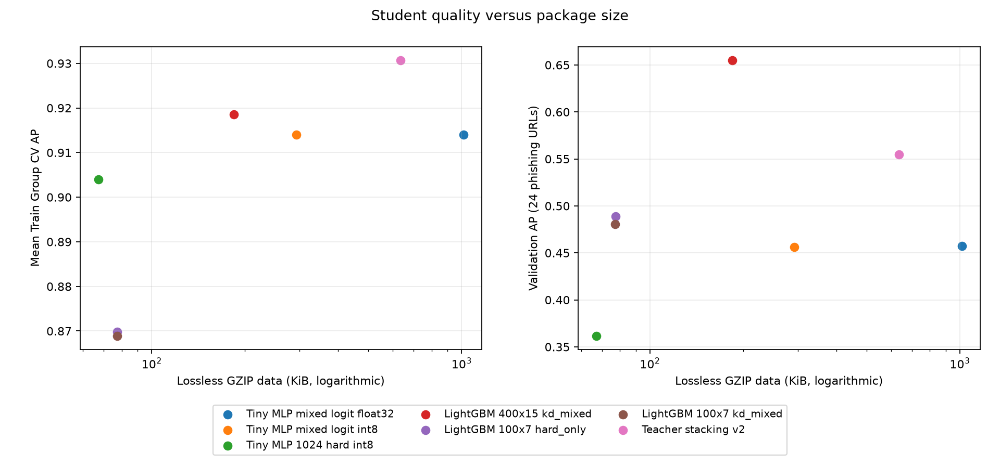

# Tuần 7 — Kiểm chứng Tiny MLP học logit và đánh đổi khi giảm kích thước

Mixed logit đứng đầu trong bốn cách huấn luyện Tiny MLP 32 nút đã thử, với mean Group CV AP 0,9140. Mức tăng so với hard-label là 0,00171 và khoảng tin cậy chứa 0. LightGBM 400 cây vẫn là Student có AP cao nhất trong các cấu hình đối chiếu. Nén gói dữ liệu của nó bằng GZIP giảm từ 1.249.389 xuống 188.759 byte và khôi phục được từng byte của gói ban đầu.

## Cách kiểm chứng

Ảnh đề xuất thiếu mã, cấu hình đặc trưng, công thức loss và thiết lập huấn luyện đầy đủ. Đây là kiểm chứng độc lập của giả thuyết, không phải tái lập từng con số trong ảnh. Cùng mạng một lớp ẩn ReLU 32 nút, TF-IDF ký tự 8.192 chiều và 20 E2, cùng 20 epochs Adam, batch 1.024, learning rate 0,003 và seeds 42–47. Hai lượt bổ sung giảm TF-IDF còn 1.024 đặc trưng bằng chi-square trên riêng tập fitting. Cấu hình ghi trong [week7_tiny_mlp.json](../configs/week7_tiny_mlp.json).

Bốn kiểu học dùng nhãn thật, trung bình nhãn và score Teacher, sai số bình phương giữa logits, hoặc trung bình BCE nhãn thật và loss logit. Logit Teacher lấy từ log-odds của score sigmoid. Loss logit chia cho phương sai logit trong phân vùng fitting, với mẫu số tối thiểu 1. Đây là một cách cân bằng thang loss, còn công thức cụ thể trong ảnh chưa xác định. Tham chiếu nền về logit matching. [Hinton và cộng sự](https://www.cs.toronto.edu/~hinton/absps/distillation.pdf)

Dùng 13.078 Train IDs và ba domain-group folds đã đóng băng. Mỗi fold dùng đúng Teacher đã fit trên phần fitting và bảng targets đã kiểm hash. Vocabulary, IDF, chọn đặc trưng và chuẩn hóa E2 đều fit bên trong fold. Teacher targets là in-sample trong fitting partition. Không fit lại Teacher. Dùng Teacher phát hành khi fit Student cuối, seed xuất 42. Ngưỡng Student cuối lấy từ Train OOF seed 42 ở ngân sách FPR 1%, sau đó giữ nguyên trên Validation. Ngưỡng Teacher giữ nguyên release. Official Test và external không được dùng trong nghiên cứu này.

## Kết quả theo loss

| Tiny MLP | Mean CV AP | SD theo seed | Validation AP, float32 | TP / FP tại ngưỡng đã khóa |
|---|---:|---:|---:|---:|
| 8.192 + hard-label | 0,91225 | 0,00090 | 0,39870 | 11 / 21 |
| 8.192 + score KD | 0,91344 | 0,00074 | 0,46590 | 11 / 17 |
| 8.192 + mixed logit | **0,91395** | 0,00070 | 0,45713 | 11 / 19 |
| 8.192 + chỉ logit | 0,90977 | 0,00101 | **0,49337** | 12 / 19 |
| 1.024 + hard-label | 0,90398 | 0,00131 | 0,35986 | 11 / 22 |
| 1.024 + mixed logit | 0,90030 | 0,00129 | 0,39651 | 10 / 18 |

Mixed logit vượt hard-label ở 6/6 seed và vượt score KD ở 5/6. Bootstrap theo domain trong từng fold, 1.000 lần và giữ cặp theo ID/seed, cho ΔAP so với hard-label +0,001706, CI 95% [−0,001383, +0,004760]. So với score KD, ΔAP +0,000512, CI [−0,001655, +0,002725]. Các seed dùng cùng folds nên số lần thắng chỉ mô tả độ ổn định qua seed. Chỉ học logit đạt AP Validation cao nhất trong nhóm Tiny, nhưng xếp sau mixed logit trên Group CV. Ảnh đề xuất cũng có chỉ-logit nhỉnh hơn mixed ở cả hai cột AP và bắt nhiều hơn một phishing tại cùng số FP, nên nếu ưu tiên mixed cần nêu rõ lý do.

## Đánh đổi chất lượng, kích thước và tốc độ

| Model | Group CV AP | Validation AP | TP / FP đã khóa | Gói trên đĩa | GZIP | p95 Python |
|---|---:|---:|---:|---:|---:|---:|
| Tiny MLP 8.192, mixed int8 | 0,9140* | 0,4565 | 11 / 19 | 351 KiB | 293 KiB | 1,14 ms |
| Tiny MLP 1.024, hard int8 | 0,9040* | 0,3619 | 11 / 22 | 124 KiB | 67 KiB | 1,18 ms |
| LightGBM 100 cây, hard-label | 0,8699 | 0,4889 | 10 / 18 | 388 KiB | 77 KiB | 1,38 ms |
| LightGBM 400 cây, hard-label | 0,9184 | 0,6223 | 13 / 10 | 1.220 KiB | 185 KiB | 4,92 ms |
| LightGBM 400 cây, KD | 0,9186 | **0,6549** | 13 / 10 | 1.220 KiB | 184 KiB | 4,81 ms |
| Teacher stacking v2 | **0,9307** | 0,5549 | **15 / 14** | 2.572 KiB | 635 KiB | 5,08 ms |

\* CV của weights float32 tương ứng. Int8 chỉ kiểm trên bản xuất seed 42 ở Validation. Tiny MLP full mixed int8 giữ nguyên mọi nhãn trên 1.585 mẫu ở ngưỡng đã khóa. AP thay đổi −0,00065 và gói trên đĩa giảm khoảng 67%. Python giải lượng tử về float32 khi nạp, nên phép đo chỉ trực tiếp chứng minh lợi ích lưu trữ. Thu từ vựng còn 1.024 làm mất khoảng 0,0083 AP CV khi so cùng hard-label. LightGBM 100 cây, 7 lá làm mất khoảng 0,0496 AP CV ở bản KD so với 400 cây, 15 lá.

Đối chiếu xếp hạng trên Validation với cùng trần 14 benign bị báo nhầm, Teacher bắt 15/24, LightGBM 400 hard-label 16/24, LightGBM 400 KD 15/24, Tiny mixed int8 11/24. Đây là phép đọc đường Recall/FPR dùng nhãn Validation sau huấn luyện. Các ngưỡng từ phép đọc này không được đưa vào model. Validation chỉ có 24 positives và đã dùng trong quá trình phát triển dự án.

Kích thước gồm một gói model cộng PSL và brand reference. NPZ của Tiny MLP đã nén bên trong, JSON của LightGBM và Teacher là file hiện có. Cột GZIP nén từng file bằng cùng một thiết lập và kiểm tra giải nén khớp byte, giúp so dung lượng lưu trữ theo cùng cách. Đây là dung lượng dữ liệu, chưa gồm runtime hoặc APK. p95 đo đầu-cuối từ raw URL trên cùng 250 URL Validation, một luồng, 30 warm-ups, bỏ qua thời gian nạp. Tiny MLP và LightGBM dùng Python reference, Teacher dùng Python release. Chưa đo giải nén, cold-start, RAM hay parity trên Android cho các thay đổi này.



## Lựa chọn theo mục tiêu

- **Ưu tiên chất lượng phát hiện ở ngưỡng hiện hành và tiến độ tích hợp.** Giữ Teacher stacking làm mốc. Nó có CV AP cao nhất và phát hiện nhiều phishing nhất tại ngưỡng đã phát hành trong bảng.
- **Ưu tiên Student với chất lượng cao và file nhỏ.** Ưu tiên kiểm tra LightGBM 400 cây với cách đóng gói giữ nguyên byte trước khi bỏ cây hay chuyển sang Tiny MLP. Bản hard-label cũng cần giữ làm đối chứng vì KD chỉ tăng 0,00015 CV AP trong thí nghiệm LightGBM trước và cả hai cho cùng TP/FP Validation tại ngưỡng đã khóa.
- **Ưu tiên tốc độ suy luận.** Tiny MLP int8 là đối án để đo tiếp vì Python có p95 khoảng 1,14 ms so với khoảng 4,81 ms của LightGBM KD trên cùng URL. Việc chấp nhận đánh đổi cần dựa trên chi phí và parity của bản Dart trên thiết bị, cộng với mức giảm chất lượng đã thấy.

## Tái lập

```powershell
python scripts/verify_tiny_mlp.py
python scripts/verify_tiny_mlp.py --analysis-only
python scripts/verify_compact_lightgbm.py
python scripts/summarize_tiny_mlp.py
```

Lệnh đầu chạy 108 lượt CV. Lệnh thứ hai đọc CV đã lưu, fit lại Student seed 42 trên toàn Train để xuất float32/int8, kiểm parity và tính bootstrap. Lệnh thứ ba chạy đối chứng LightGBM 100 cây. Lệnh cuối đo thời gian và tổng hợp kích thước/metrics, không fit model.

Bảng đầy đủ nằm ở [tradeoff.csv](tables/student_tiny_mlp/tradeoff.csv), [paired_bootstrap.csv](tables/student_tiny_mlp/paired_bootstrap.csv) và [validation_matched_fp.csv](tables/student_tiny_mlp/validation_matched_fp.csv). Mỗi artifact Tiny MLP có SHA-256 trong [manifest](../artifacts/student_tiny_mlp/manifest.json).
