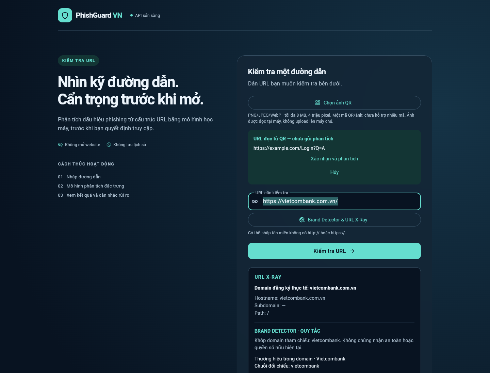
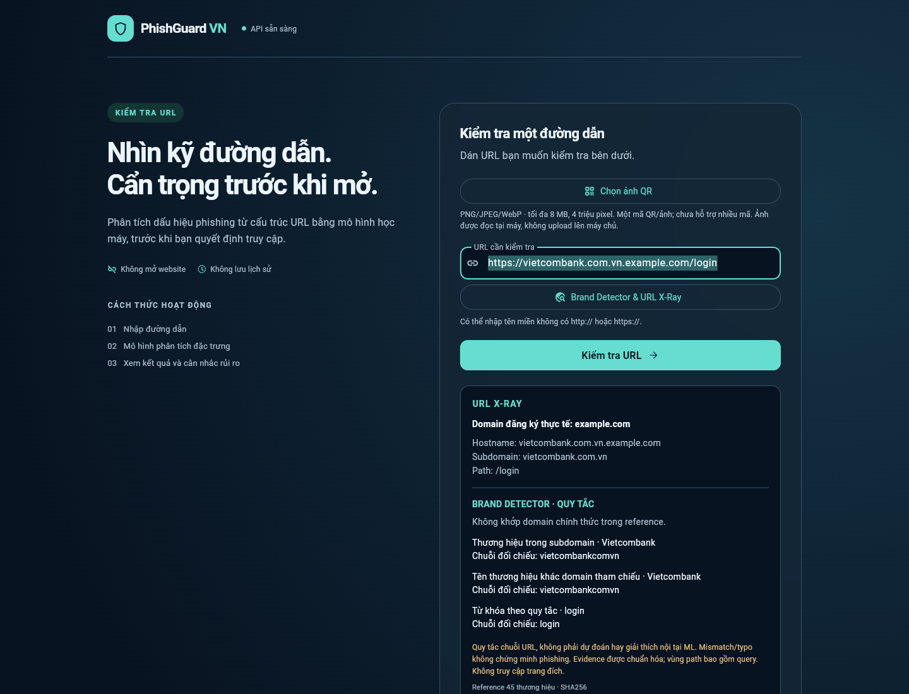
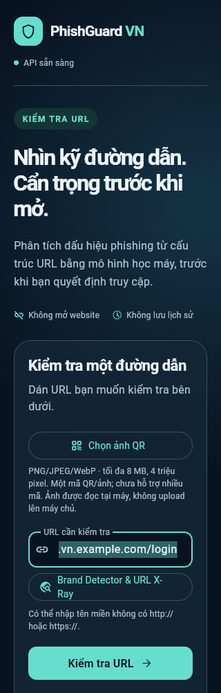
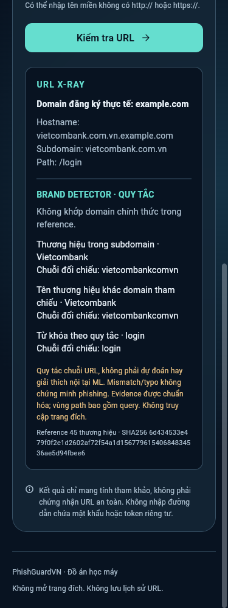
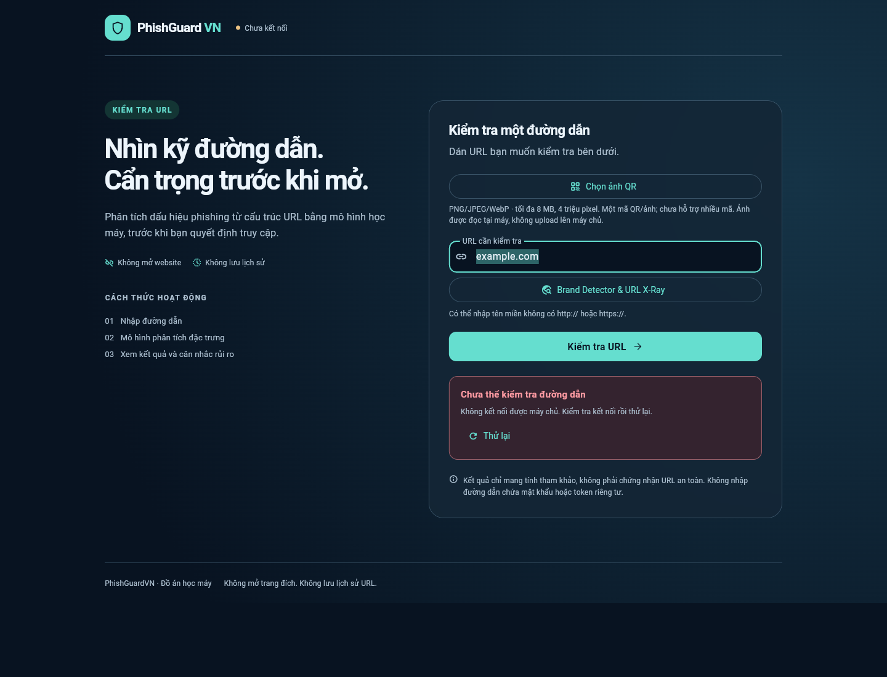

# Week 7 — Hưng / Issue #30 verification và bàn giao

Ngày 17/11/2026, branch `feat/w7-hung-web-analysis`, base main
`19eaaa3f3ddbd4d6e1ffaef01a6c31ce89b02fcf`. PR #22/#23/#25/#21 đã merge;
tiếp tục implementation đã có, không sửa nhánh QA/Android/Student.
Revision nền lúc chạy khác commit publish. [Verification JSON](tables/week7/verification.json)
ghi source hashes của code chạy thật; PR head định danh commit bàn giao.

## Implementation / HU7.1–HU7.4

- QR ảnh: file selector Web → image pixels → ZXing decoder thật, preview URL đầy đủ,
  xác nhận rồi mới `/predict`. PNG/JPEG/WebP, 8 MiB và 4×1024² pixel;
  **một mã/ảnh**, chưa hỗ trợ nhiều QR/camera. Không upload ảnh lên backend.
  QR không phải URL, ảnh hỏng/không QR, cancel, lỗi API và retry có trạng thái riêng.
- `/inspect` adapter riêng dùng parser/matcher/reference 45 brands hiện tại.
  X-Ray hiển thị hostname, registrable domain thực, subdomain/path; Brand Detector
  hiển thị official-reference match và evidence mismatch/subdomain/path-query/
  typo/homoglyph/IDNA/IP trong phạm vi engine. Không thay công thức E2/reference.
  Đây là rule-based evidence, không là nhãn phishing chắc chắn hoặc intrinsic ML attribution.
- `/predict` và `/health` giữ tương thích. Teacher **teacher-stacking-v2**, CPython
  **3.11.17**, threshold **0.6945740700635259** đọc release lock; rule
  **score >= threshold**, score LR chưa hiệu chuẩn. SHA256 bundle
  **63199c925b28492765019de84c178bd3f8b935a0031f6c960b5db6c31a57c4f1**.
  Không fallback E1, đổi nhãn, threshold, artifact hoặc promotion metadata.
- Input giữ khi lỗi, request cùng loại không trùng, response cũ bị bỏ nếu URL đổi.
  Selection/focus không được coi là đổi URL. Đây là lỗi phát hiện và sửa bằng
  browser thật, có regression test riêng. Text nút chính wrap khi tăng cỡ chữ.

## Design system thực sự áp dụng

Đã đọc UI UX Pro Max **2.15.0** tại `~/.agents/skills/ui-ux-pro-max/SKILL.md`,
[MASTER](../apps/web/design-system/phishguardvn/MASTER.md), README và UI hiện có.
Đã chạy `search.py 'error recovery file upload' --domain ux -n 3` và
`search.py 'responsive form accessibility' --stack flutter -n 3` để áp dụng
recovery action, validation, live-region semantics và layout constraints.
Giữ navy/cyan, warning red + chữ/icon, kính mờ tiết chế, Material 3/Roboto local;
max width 1180, hai cột khi content width ≥860, mobile dọc. Không tạo dashboard
hoặc tái sinh palette. Bằng chứng E1/Teacher-pending trong tài liệu cũ là lịch sử.

## Kết quả kiểm thử thực tế

Môi trường local **macOS arm64**, CPython 3.11.17 theo `requirements-teacher.txt`,
Flutter **3.47.9**, Dart **3.13.7**, Chrome **157.0.8103.79**. Không nhận đã test
Windows hoặc thiết bị Android thật; CI/QA Khiêm xác nhận các môi trường đó.

| Kiểm tra | Kết quả |
|---|---|
| `python -m pytest -q tests/test_url_inspection.py tests/test_api.py tests/test_api_teacher.py` | **73 passed**, 0 failed/skipped |
| Full QA: `python -m pytest -p no:cacheprovider -q -rs --teacher-root=. --teacher-api -k 'not test_real_external_bundle_matches_saved_scores'` | **639 passed, 2 skipped, 1 deselected**, 4 warnings upstream sklearn |
| `cd apps/web; flutter analyze` | **No issues found** |
| `flutter test` | **47 passed, 0 failed/skipped** |
| `flutter build web --release --no-web-resources-cdn --dart-define=API_BASE_URL=http://127.0.0.1:8001` | **PASS**, assets local |
| Python loader–HTTP, Teacher thật | **10/10 parity**, score atol 1e-12, label/threshold/rule/score semantics exact |
| Chrome release Web → API → Teacher | **18 checks PASS**, 0 page errors, 0 attempted external requests |
| `python scripts/analyze_week7_teacher_errors.py` | **PASS**, 79 errors từ saved predictions; hashes/labels/threshold/counts khớp |
| `git diff --check` | **PASS** |

Hai skip giữ nguyên: empty brand regression parameter set; notebook 02/03 local
handoff chưa có. Một deselection theo `tests/README.md`: không chấm lại external
cho QA Web. Không xóa/nới assertion. Lượt analyze từ repository root bắt cả mobile
chưa cài deps và không phải check Web; lệnh đúng trong `apps/web` ở trên đã pass.

Unit/widget tests dùng HTTP fixtures chỉ để kiểm contract/errors/stale state;
ảnh QR PNG thật đi qua decoder thực (bao gồm PNG 1-bit, lỗi/non-URL và quá giới hạn).
Network guards của API bao phủ DNS/socket sau TestClient bootstrap, giữ tương thích
cách sửa Windows Week 6. `/inspect` không phụ thuộc model; reference lỗi trả 503
sanitized, restore/retry phục hồi. Cỡ chữ **200% tại 320px** được kiểm widget,
kèm reduced motion/contrast tests; không nhận đây là audit WCAG đầy đủ.

## Bốn luồng demo và lỗi đã chạy bằng browser thật

[Smoke JSON](tables/week7/browser_smoke.json), [Python/API parity](tables/week7/python_api_parity.json).
Port lượt chạy này: API **8001**, Web **3001** để không dừng server làm việc khác;
CORS origin `http://127.0.0.1:3001`. Lệnh chuẩn 8000/3000 và môi trường sạch xem
[backend guide](../docs/backend.md), [Web README](../apps/web/README.md).

1. Nhập `example.com` → benign; URL Validation ID
   `024efd11-58b4-57c4-8d40-383a1034b19f` (`9944789[.]com`) → phishing thật.
   Không truy cập domain đích. UI giữ nhãn/model/score/threshold backend.
2. File picker chọn `qr_url.png` → decode `https://example.com/Login?Q=A` → preview;
   số `/predict` không tăng trước xác nhận. Sau xác nhận score thật 0.5760558654872865,
   benign dù >0.5. Ảnh hỏng/no QR/text/javascript đều bị từ chối, chọn lại được.
3. Brand Detector: official Vietcombank domain và subdomain `vietcombank.com.vn`
   dưới domain `example.com` có evidence thật; mismatch không biến thành nhãn ML.
4. X-Ray cùng panel hiển thị domain/subdomain/path; viewport desktop 1440,
   tablet 768, mobile 375/320px, không document horizontal overflow.

Đã chạy input rỗng, invalid port, URL dài, Tab focus và prefers-reduced-motion.
Đã **SIGTERM backend thật**, thấy network error; restart/retry cùng trang phục hồi.
Đã restart backend không cấu hình model, thấy 503 MODEL_UNAVAILABLE; restore
Teacher/retry phục hồi. Không mock response, sửa prediction hoặc sinh ảnh demo.

Ảnh là screenshot Chrome thật, không có video được nhận là đã quay. Mobile là
viewport emulation, không thiết bị thật. Font/CanvasKit/API chỉ gọi localhost;
không HTTP/DNS tới URL người dùng. Backend không log raw URL, không trả traceback/path.

## HU7.5–HU7.6 / bàn giao và giới hạn còn lại

[Modeling/Evaluation](week7_modeling_evaluation.md) có 79 FP/FN, mẫu số/nguồn,
nhóm evidence chồng lấp, ví dụ defanged, giả thuyết kiểm chứng và source bias.
Validation 14 FP/9 FN; external lịch sử 1 FP/55 FN. Không tạo benchmark mới,
không tune external/Official Test, không tự thêm human verification.
Student receipt từ Phúc revision `37581b2`: development metrics, Validation đã
tham gia chọn model/ngưỡng, **NO-GO thay Teacher**, Android verification chưa có.

Hưng đã self-review API validation, rule/ML separation, no-network, stale responses,
QR confirmation và bất biến nghiên cứu; sửa hai lỗi UI có bằng chứng (selection
invalidation, nút overflow khi scale). Diff không đổi data/labels/splits/folds,
Teacher/E1/E2/reference/config/models, Student, Android hoặc notebook outputs.
Không tự approve/merge PR hoặc nhận QA độc lập đã hoàn tất.

Bàn giao Khiêm **#31**: contract `/inspect` + errors trong docs/api_contract.md;
fixtures trong apps/web/test/fixtures và tests/test_url_inspection.py; lệnh/test
results/smoke records ở trên. Khiêm tiếp tục security, clean clone, Windows/device
và independent regression/PR review. Phúc/Hy tiếp tục Student/Android #28/#29;
không là blocker của Web Teacher hiện tại. Issue #30 giữ mở để review, không tự đóng.

## Regression focus URL sau lỗi QR, 18/11/2026

Khiêm QA độc lập trên Windows tại `701b8f5`. API và Flutter tests đạt, browser
thật đạt 19/20 ca. Ca lỗi mất focus sau khi chọn ảnh QR hỏng, quay lại ô URL,
nhấn Ctrl+A rồi Backspace. [Review của Khiêm](https://github.com/phuctran33/PhishGuardVN/pull/32#pullrequestreview-5939167301).

Hưng tái hiện trên release cũ bằng Chrome 157.0.8103.80 headless, macOS arm64.
Ở desktop 1440 px, nhập `example.com`, chọn `broken.png`, click ô URL, giữ
Shift và nhấn mũi tên trái để chọn hết text, rồi nhấn Backspace. Cả ca chỉ có
lỗi QR và ca có thêm `/predict` và `/inspect` đều xóa text, nhưng phím tiếp
theo rơi vào `BODY`. `MutationObserver` ghi nhận Chrome phát `blur` và Flutter
Web gỡ rồi chèn lại cùng DOM `<form>`. Khi lỗi QR biến mất, form dời lên qua
phần giới thiệu trong thứ tự accessibility chung. `FocusNode` ở tầng Flutter
vẫn tồn tại, nên widget test kiểm cả thứ tự các node accessibility còn lại.

Bản sửa đặt vùng nhập liệu trong một `Semantics` container riêng để nội dung
giới thiệu và form giữ thứ tự độc lập. `_inputChanged()` tăng revision khi text
thực sự đổi và chỉ gọi `setState()` nếu có feedback cần dọn. Các notification
chỉ đổi selection/caret giữ kết quả và revision hiện tại.

| Kiểm tra cục bộ của Hưng | Kết quả |
| --- | --- |
| Regression widget trên `701b8f5` | **FAIL như kỳ vọng** tại assertion thứ tự accessibility |
| `flutter analyze` | **PASS**, không có issue |
| `flutter test` | **48 PASS**, gồm regression, QR hợp lệ/cancel và stale responses |
| `flutter build web --release` | **PASS** |
| Build release cho browser với `--no-web-resources-cdn --dart-define=API_BASE_URL=http://127.0.0.1:18032` | **PASS** |
| Chrome macOS, bàn phím thật qua Playwright | **4/4 PASS**. QR hỏng desktop, QR hỏng kèm prediction và inspection desktop, ca tương tự ở 375 px, và QR hợp lệ đang preview ở desktop |

Trong cả bốn ca browser, ô URL vẫn là cùng DOM input sau Backspace, không có
`blur` hay tháo gắn form. Gõ tiếp `example.org` vào được ngay. Lỗi/preview QR
biến mất khi text đổi. Các ca có kết quả thực dùng API và Teacher cục bộ, xác
nhận prediction và inspection biến mất sau khi xóa. Bản sửa chờ Khiêm kiểm tra
lại tổ hợp Ctrl+A → Backspace trên Chrome Windows.
